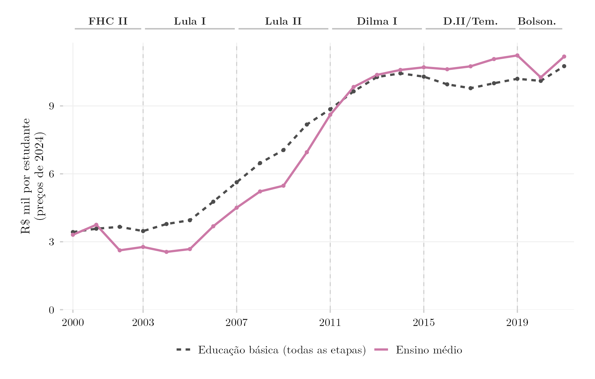

## Visão Geral

Esta figura acompanha quanto o Estado brasileiro, somando União, estados e municípios, investiu diretamente por estudante na educação básica e no ensino médio. Em termos reais, o investimento por estudante da educação básica praticamente triplicou entre 2000 e 2014, assim como o do ensino médio, e pouco cresceu depois de 2014. O investimento por estudante do ensino médio caiu no início dos anos 2000, quando as regras do Fundef privilegiavam o ensino fundamental, e alcançou a média da educação básica por volta de 2011.

## Metodologia

**Fonte.** INEP, Indicadores Financeiros Educacionais, planilha `Investimento_estudante_valor_nominal.xlsx` (versão de 10 de setembro de 2024), com o investimento por estudante por etapa de ensino em reais correntes, 2000–2021.

**Conceito.** O investimento público direto inclui pessoal ativo, outras despesas correntes e investimentos das três esferas de governo. Exclui aposentadorias e pensões, bolsas, financiamento estudantil, serviço da dívida e transferências ao setor privado.

**Deflator.** Os valores nominais são deflacionados pela média anual do Índice Nacional de Preços ao Consumidor Amplo (IPCA, tabela 1737 do SIDRA) para preços de 2024. O INEP também publica uma planilha "valor real", mas suas edições usam bases de preço diferentes (2018 e 2021); por isso a série nominal é deflacionada aqui com um único deflator.

Os rótulos no topo indicam o presidente em exercício.

## Como Citar

Se você usar esta figura ou o pipeline que a gera, cite tanto a dissertação quanto esta análise específica. As referências seguem a 7ª edição da APA.

**Dissertação (em elaboração; a entrada será atualizada após a defesa):**

> Mançano, T. (2026). *Inequality in access to tertiary education in Brazil: Household incomes, reforming policies, and the politics of who gets in (1990s–2020s)* [Dissertação de mestrado não publicada]. Universidade de São Paulo.

**Esta figura e o pipeline:**

> Mançano, T. (2026, 14 de novembro). *Investimento público por estudante na educação básica, Brasil 2000–2021* [Figura e pipeline reprodutível]. Open Data Analysis. https://mancano-tales.github.io/open-data-analysis/pt/posts-pt/gasto-estudante-educacao-basica/

**No texto:** (Mançano, 2026) — ao citar várias análises deste catálogo no mesmo trabalho, a APA as distingue como 2026a, 2026b, … na ordem em que aparecem na lista de referências.

**BibTeX:**

```bibtex
@mastersthesis{Mancano2026Thesis,
  author = {Man\c{c}ano, Tales},
  title  = {Inequality in Access to Tertiary Education in Brazil: Household
            Incomes, Reforming Policies, and the Politics of Who Gets In
            (1990s--2020s)},
  school = {University of S\~{a}o Paulo},
  year   = {2026},
  type   = {Master's thesis},
  note   = {Unpublished; Graduate Program in Political Science}
}

@misc{Mancano2026_gasto_estudante_educacao_basica_pt,
  author       = {Man\c{c}ano, Tales},
  title        = {Investimento p\'{u}blico por estudante na educa\c{c}\~{a}o b\'{a}sica, Brasil 2000--2021},
  year         = {2026},
  month        = nov,
  howpublished = {Open Data Analysis, \url{https://mancano-tales.github.io/open-data-analysis/pt/posts-pt/gasto-estudante-educacao-basica/}},
  note         = {Figura e pipeline reprodutível. Código-fonte: \url{https://github.com/mancano-tales/open-data-analysis}, pasta posts-pt/gasto-estudante-educacao-basica/. Acesso em AAAA-MM-DD}
}
```

Uma versão permanente (tag do Git + DOI no Zenodo) será linkada aqui assim que a dissertação for defendida; até lá, cite a URL da página acima e acrescente a data de acesso (código-fonte: https://github.com/mancano-tales/open-data-analysis, pasta `posts-pt/gasto-estudante-educacao-basica/`).

## Pipeline

Scripts desta análise:

- Plotagem: [`plot.R`](../../posts/gasto-estudante-educacao-basica/plot.R) — lê `data/` e grava `fig-en.png`, `fig-pt.png` e `thumbnail.png`.
- Dados: [`shared-pipeline/gasto-educacao-basica/010_INEP_Investimento_Estudante.R`](../../shared-pipeline/gasto-educacao-basica/010_INEP_Investimento_Estudante.R) baixa a planilha do INEP ([Indicadores Financeiros Educacionais](https://www.gov.br/inep/pt-br/acesso-a-informacao/dados-abertos/indicadores-educacionais/indicadores-financeiros-educacionais)) e o IPCA da tabela 1737 do SIDRA, e grava os dois arquivos de `data/`. A planilha confere com o md5 que o INEP publica junto com ela.

## Reprodutibilidade

**Tier: A**

Este pipeline usa apenas dados públicos, acessíveis sem credencial. Os dois CSVs em `data/` bastam para redesenhar a figura.
