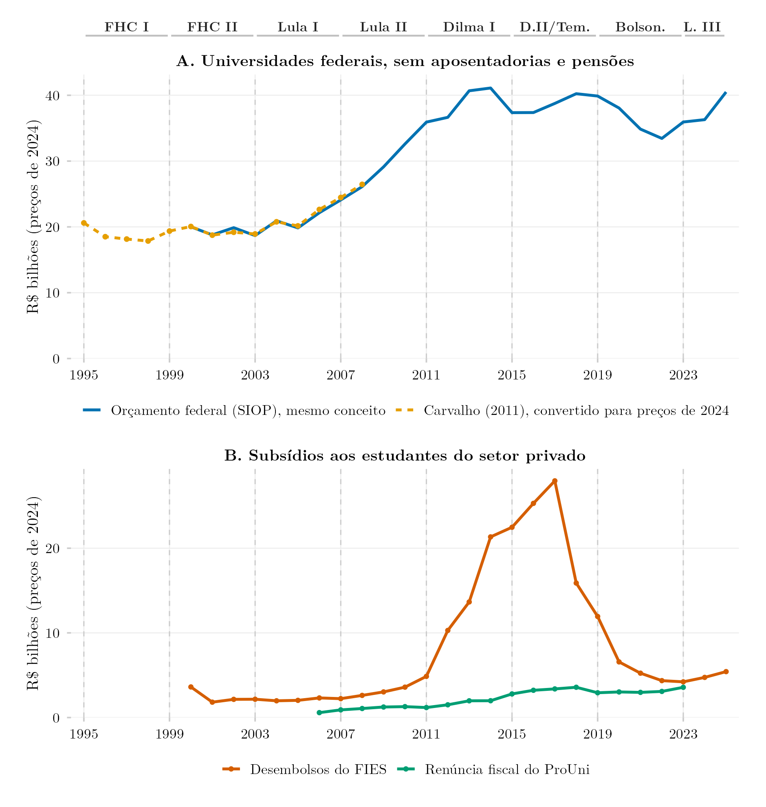

## Visão Geral

Esta figura compara as duas formas pelas quais a União paga pela educação terciária no Brasil: financiando as suas próprias universidades, que são gratuitas, e subsidiando estudantes em instituições privadas. O gasto com as universidades federais, sem aposentadorias e pensões, praticamente dobrou entre 2003 e 2014 e desde então oscila abaixo desse pico. Os desembolsos do FIES subiram de cerca de R$ 5 bilhões em 2011 para quase R$ 28 bilhões em 2017, a preços de 2024, e voltaram a cerca de R$ 4 bilhões em 2022, enquanto a renúncia fiscal do ProUni nunca passou de R$ 4 bilhões por ano.

## Metodologia

**Painel A, universidades federais.** Gasto das unidades orçamentárias das universidades federais, sem aposentadorias e pensões, sentenças judiciais, a contribuição patronal à previdência registrada no orçamento desde 2006 e os benefícios aos servidores, no conceito de Carvalho (2011, Tabela VII). De 2000 a 2025, a série usa o gasto liquidado no orçamento federal, obtido nos dados abertos do SIOP pelo endpoint SPARQL público em outubro de 2026. Para 1995–2008, a figura mostra também a série do próprio Carvalho, convertida de preços de 2008 para 2024 com o mesmo deflator; as duas se sobrepõem em 2000–2008.

**Painel B, subsídios aos estudantes do setor privado.** FIES: gasto liquidado com a concessão de financiamento (ações 0579 e 00IG), sem a administração do fundo e a integralização de cotas dos fundos garantidores. ProUni: a renúncia dos tributos federais dispensados às instituições participantes (IRPJ, CSLL, PIS-Pasep e Cofins), segundo o Demonstrativo dos Gastos Tributários – Bases Efetivas da Receita Federal, usando para cada ano a edição do próprio ano (2006–2023).

**Deflator.** Média anual do Índice Nacional de Preços ao Consumidor Amplo (IPCA, tabela 1737 do SIDRA), preços de 2024. Os rótulos no topo indicam o presidente em exercício.

## Como Citar

Se você usar esta figura ou o pipeline que a gera, cite tanto a dissertação quanto esta análise específica. As referências seguem a 7ª edição da APA.

**Dissertação (em elaboração; a entrada será atualizada após a defesa):**

> Mançano, T. (2026). *Inequality in access to tertiary education in Brazil: Household incomes, reforming policies, and the politics of who gets in (1990s–2020s)* [Dissertação de mestrado não publicada]. Universidade de São Paulo.

**Esta figura e o pipeline:**

> Mançano, T. (2026, 14 de novembro). *Gasto federal com as universidades e com os estudantes do setor privado, Brasil 1995–2025* [Figura e pipeline reprodutível]. Open Data Analysis. https://mancano-tales.github.io/open-data-analysis/pt/posts-pt/gasto-federal-educacao-superior/

**No texto:** (Mançano, 2026) — ao citar várias análises deste catálogo no mesmo trabalho, a APA as distingue como 2026a, 2026b, … na ordem em que aparecem na lista de referências.

**BibTeX:**

```bibtex
@mastersthesis{Mancano2026Thesis,
  author = {Man\c{c}ano, Tales},
  title  = {Inequality in Access to Tertiary Education in Brazil: Household
            Incomes, Reforming Policies, and the Politics of Who Gets In
            (1990s--2020s)},
  school = {University of S\~{a}o Paulo},
  year   = {2026},
  type   = {Master's thesis},
  note   = {Unpublished; Graduate Program in Political Science}
}

@misc{Mancano2026_gasto_federal_educacao_superior_pt,
  author       = {Man\c{c}ano, Tales},
  title        = {Gasto federal com as universidades e com os estudantes do setor privado, Brasil 1995--2025},
  year         = {2026},
  month        = nov,
  howpublished = {Open Data Analysis, \url{https://mancano-tales.github.io/open-data-analysis/pt/posts-pt/gasto-federal-educacao-superior/}},
  note         = {Figura e pipeline reprodutível. Código-fonte: \url{https://github.com/mancano-tales/open-data-analysis}, pasta posts-pt/gasto-federal-educacao-superior/. Acesso em AAAA-MM-DD}
}
```

Uma versão permanente (tag do Git + DOI no Zenodo) será linkada aqui assim que a dissertação for defendida; até lá, cite a URL da página acima e acrescente a data de acesso (código-fonte: https://github.com/mancano-tales/open-data-analysis, pasta `posts-pt/gasto-federal-educacao-superior/`).

## Pipeline

Scripts desta análise:

- Plotagem: [`plot.R`](../../posts/gasto-federal-educacao-superior/plot.R) — lê `data/` e grava `fig-en.png`, `fig-pt.png` e `thumbnail.png`. Os valores da Tabela VII de Carvalho (2011) estão digitados no script.
- Dados: `data/gasto_federal_es_anual.csv` traz as três séries anuais em reais correntes e de 2024, montadas a partir da execução orçamentária do SIOP e dos demonstrativos de gastos tributários da Receita Federal ([Gastos Tributários – Bases Efetivas](https://www.gov.br/receitafederal/pt-br/centrais-de-conteudo/publicacoes/relatorios/renuncia/gastos-tributarios-bases-efetivas)), e `data/ipca_media_anual.csv` é a média anual do número-índice do IPCA, da tabela 1737 do SIDRA.

## Reprodutibilidade

**Tier: A**

Este pipeline usa apenas dados públicos, acessíveis sem credencial. Os dois CSVs em `data/` bastam para redesenhar a figura.

**Referência:** Carvalho, H. A. de (2011). *A política pública para a educação superior no Brasil (1995–2008): Ruptura e/ou continuidade?* [Tese de doutorado, Universidade Estadual de Campinas]. https://doi.org/10.47749/T/UNICAMP.2011.784998 — Tabela VII, p. 331.
