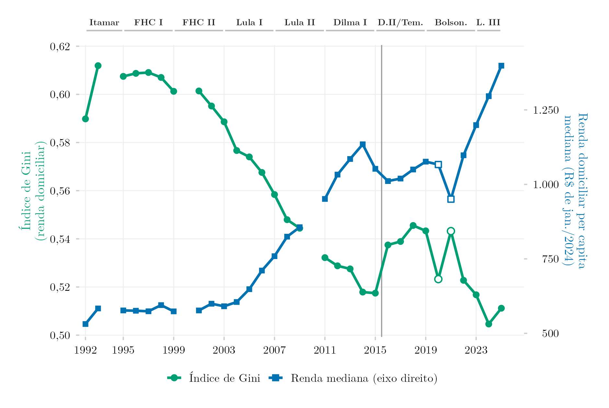

## Visão Geral

Esta figura põe no mesmo eixo de tempo as duas séries de renda que mais importam para a trajetória do acesso à educação terciária no Brasil: o quanto a renda das famílias é desigual (o índice de Gini, eixo esquerdo) e quanta renda tem a família no meio da distribuição (a renda domiciliar per capita mediana, eixo direito). O Gini ficou perto do seu pico nos anos 1990, caiu de forma contínua de 2001 a 2015, subiu entre 2016 e 2018 e voltou a cair a partir de 2022, até o menor nível da série. A renda mediana ficou estagnada nos anos 1990 e no início dos anos 2000, quase dobrou entre 2003 e 2014, caiu de 2015 a 2021 e se recuperou até o seu pico histórico em 2025.

## Metodologia

**Índice de Gini.** Renda domiciliar per capita no universo oficial, que mantém os domicílios sem renda, como faz o IBGE. A série reproduz o Gini publicado pelo IBGE (desvio médio de −0,0001) e é a mesma do painel A do [painel de Gini e Palma](../desigualdade-renda-gini-palma-decil/).

**Renda mediana.** Mediana ponderada da renda domiciliar per capita real de toda a população, deflacionada pelo Índice Nacional de Preços ao Consumidor Amplo (IPCA) para preços de janeiro de 2024. A renda é sempre per capita dentro do domicílio, e os domicílios sem renda são mantidos. A série é a mesma do [post da renda mediana](../renda-mediana-domiciliar-pc/).

**Quebras e marcadores.** As linhas são interrompidas em 1994, 2000 e 2010, anos sem PNAD. Os marcadores vazados de 2020 e 2021 vêm da visita 5 da PNAD Contínua, coletada sobretudo por telefone, o que subestima a renda dos mais pobres. A linha vertical marca a troca da PNAD pela PNAD Contínua em 2016, sem reescalonamento. Na sobreposição de 2012 a 2015, a PNAD Contínua dá um Gini cerca de 0,008 mais alto, perto de um terço do degrau observado entre 2015 e 2016. O eixo direito é escalonado para que as duas séries ocupem a mesma faixa vertical; o cruzamento das linhas não tem significado próprio. Os rótulos no topo indicam o presidente em exercício.

## Como Citar

Se você usar esta figura ou o pipeline que a gera, cite tanto a dissertação quanto esta análise específica. As referências seguem a 7ª edição da APA.

**Dissertação (em elaboração; a entrada será atualizada após a defesa):**

> Mançano, T. (2026). *Inequality in access to tertiary education in Brazil: Household incomes, reforming policies, and the politics of who gets in (1990s–2020s)* [Dissertação de mestrado não publicada]. Universidade de São Paulo.

**Esta figura e o pipeline:**

> Mançano, T. (2026, 14 de novembro). *Índice de Gini e renda domiciliar mediana, Brasil 1992–2025* [Figura e pipeline reprodutível]. Open Data Analysis. https://mancano-tales.github.io/open-data-analysis/pt/posts-pt/gini-renda-mediana/

**No texto:** (Mançano, 2026) — ao citar várias análises deste catálogo no mesmo trabalho, a APA as distingue como 2026a, 2026b, … na ordem em que aparecem na lista de referências.

**BibTeX:**

```bibtex
@mastersthesis{Mancano2026Thesis,
  author = {Man\c{c}ano, Tales},
  title  = {Inequality in Access to Tertiary Education in Brazil: Household
            Incomes, Reforming Policies, and the Politics of Who Gets In
            (1990s--2020s)},
  school = {University of S\~{a}o Paulo},
  year   = {2026},
  type   = {Master's thesis},
  note   = {Unpublished; Graduate Program in Political Science}
}

@misc{Mancano2026_gini_renda_mediana_pt,
  author       = {Man\c{c}ano, Tales},
  title        = {\'{I}ndice de Gini e renda domiciliar mediana, Brasil 1992--2025},
  year         = {2026},
  month        = nov,
  howpublished = {Open Data Analysis, \url{https://mancano-tales.github.io/open-data-analysis/pt/posts-pt/gini-renda-mediana/}},
  note         = {Figura e pipeline reprodutível. Código-fonte: \url{https://github.com/mancano-tales/open-data-analysis}, pasta posts-pt/gini-renda-mediana/. Acesso em AAAA-MM-DD}
}
```

Uma versão permanente (tag do Git + DOI no Zenodo) será linkada aqui assim que a dissertação for defendida; até lá, cite a URL da página acima e acrescente a data de acesso (código-fonte: https://github.com/mancano-tales/open-data-analysis, pasta `posts-pt/gini-renda-mediana/`).

## Pipeline

Scripts desta análise:

- Plotagem: [`plot.R`](../../posts/gini-renda-mediana/plot.R) — lê `data/` e grava `fig-en.png`, `fig-pt.png` e `thumbnail.png`.
- Dados de origem: `data/gini_oficial_anual.csv` vem de [`shared-pipeline/pnadc/238_Serie_Desigualdade_Oficial.R`](../../shared-pipeline/pnadc/238_Serie_Desigualdade_Oficial.R) (os scripts de que ele depende estão no [painel de Gini e Palma](../desigualdade-renda-gini-palma-decil/)), e `data/renda_mediana_anual.csv`, do pipeline do [post da renda mediana](../renda-mediana-domiciliar-pc/).

## Reprodutibilidade

**Tier: A**

Este pipeline usa apenas dados públicos, acessíveis sem credencial (PNADcIBGE e o FTP do IBGE). Os dois CSVs em `data/` bastam para redesenhar a figura.
