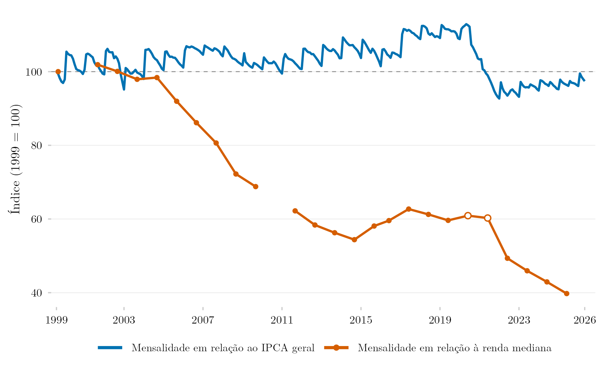

## Visão Geral

Esta figura acompanha como as mensalidades do ensino superior no Brasil se moveram desde 1999 em relação a dois referenciais: os preços gerais ao consumidor e a renda domiciliar per capita mediana. Em relação à renda mediana, a mensalidade caiu a cerca de 40% do nível de 1999 até 2025. A maior parte da queda ocorreu entre 2004 e 2014 e depois de 2021. A figura complementa a [versão com o salário mínimo](../ipca-mensalidade-curso-superior/).

## Metodologia

**O subitem.** O índice de mensalidades é o subitem 8101005 do IPCA, chamado `Curso terceiro grau` em 1999–2006 e `Ensino superior` depois disso. Ele integra o item Cursos regulares, ao lado de Creche, Pré-escola, Ensino fundamental, Ensino médio, Pós-graduação, Educação de jovens e adultos e Curso técnico, cada um com subitem próprio. A série une as tabelas 655, 2938, 1419 e 7060 do SIDRA e acumula as variações mensais desde agosto de 1999.

**A coleta.** Segundo o [manual vigente do IBGE](https://biblioteca.ibge.gov.br/visualizacao/livros/liv101767.pdf) (8ª ed., 2020), o preço é o valor da semestralidade em estabelecimentos de ensino formal, com as taxas obrigatórias e sem eventuais descontos. Os preços são pesquisados no início de cada semestre, entram em geral nos índices de fevereiro e março e de agosto e setembro, e costumam ser repetidos até o levantamento seguinte. Em cada área, a variação do subitem combina a razão de preços médios entre estabelecimentos (Dutot) e a média geométrica entre produtos (Jevons).

**Cobertura.** O IPCA acompanha famílias com rendimentos de 1 a 40 salários mínimos em áreas urbanas: hoje são 16, depois da entrada de Campo Grande e Vitória em janeiro de 2014 e de Rio Branco, São Luís e Aracaju em maio de 2018.

**As duas séries.** A série azul deflaciona o índice de mensalidades pelo IPCA geral, com agosto de 1999 = 100. A série laranja divide o índice de mensalidades pela mediana nominal da renda domiciliar per capita. Como a renda só é observada nos anos de pesquisa, cada ponto compara as duas no mês de referência da pesquisa (setembro na PNAD e junho na PNAD Contínua), e ambas valem 100 em setembro de 1999. A linha é interrompida em 2000 e 2010, anos sem pesquisa. Os marcadores vazados de 2020 e 2021 vêm da visita 5 da PNAD Contínua. A mudança de pesquisa em 2015–2016 não é reescalonada: usar a PNAD Contínua em 2012–2014, quando as duas pesquisas coexistem, elevaria o índice em 2,3 a 3,4 pontos.

**Limites.** O índice mede variações de preço, e não o nível de preços ou a mensalidade média do mercado. Por acompanhar os mesmos produtos ao longo do tempo, ele não mede quedas da mensalidade média que resultem de mudanças na composição da oferta. Os manuais do IBGE não publicam a lista de cursos e estabelecimentos da amostra nem informam se cursos a distância fazem parte dela.

## Como Citar

Se você usar esta figura ou o pipeline que a gera, cite tanto a dissertação quanto esta análise específica. As referências seguem a 7ª edição da APA.

**Dissertação (em elaboração; a entrada será atualizada após a defesa):**

> Mançano, T. (2026). *Inequality in access to tertiary education in Brazil: Household incomes, reforming policies, and the politics of who gets in (1990s–2020s)* [Dissertação de mestrado não publicada]. Universidade de São Paulo.

**Esta figura e o pipeline:**

> Mançano, T. (2026, 6 de novembro). *Mensalidades do ensino superior em relação à inflação e à renda mediana* [Figura e pipeline reprodutível]. Open Data Analysis. https://mancano-tales.github.io/open-data-analysis/pt/posts-pt/ipca-mensalidade-renda-mediana/

**No texto:** (Mançano, 2026) — ao citar várias análises deste catálogo no mesmo trabalho, a APA as distingue como 2026a, 2026b, … na ordem em que aparecem na lista de referências.

**BibTeX:**

```bibtex
@mastersthesis{Mancano2026Thesis,
  author = {Man\c{c}ano, Tales},
  title  = {Inequality in Access to Tertiary Education in Brazil: Household
            Incomes, Reforming Policies, and the Politics of Who Gets In
            (1990s--2020s)},
  school = {University of S\~{a}o Paulo},
  year   = {2026},
  type   = {Master's thesis},
  note   = {Unpublished; Graduate Program in Political Science}
}

@misc{Mancano2026_ipca_mensalidade_renda_mediana_pt,
  author       = {Man\c{c}ano, Tales},
  title        = {Mensalidades do ensino superior em rela\c{c}\~{a}o \`{a} infla\c{c}\~{a}o e \`{a} renda mediana},
  year         = {2026},
  month        = nov,
  howpublished = {Open Data Analysis, \url{https://mancano-tales.github.io/open-data-analysis/pt/posts-pt/ipca-mensalidade-renda-mediana/}},
  note         = {Figura e pipeline reprodutível. Código-fonte: \url{https://github.com/mancano-tales/open-data-analysis}, pasta posts-pt/ipca-mensalidade-renda-mediana/. Acesso em AAAA-MM-DD}
}
```

Uma versão permanente (tag do Git + DOI no Zenodo) será linkada aqui assim que a dissertação for defendida; até lá, cite a URL da página acima e acrescente a data de acesso (código-fonte: https://github.com/mancano-tales/open-data-analysis, pasta `posts-pt/ipca-mensalidade-renda-mediana/`).

## Pipeline

Scripts desta análise:

- Plotagem: [`plot.R`](../../posts/ipca-mensalidade-renda-mediana/plot.R) — lê `data/` e grava `fig-en.png`, `fig-pt.png` e `thumbnail.png`.
- Dados de origem: `data/mensalidade_mensal.csv` vem de [`shared-pipeline/ipca/010_IPCA_Curso_Superior_Series.R`](../../shared-pipeline/ipca/010_IPCA_Curso_Superior_Series.R), e `data/renda_mediana_anual.csv`, do pipeline do [post da renda mediana](../renda-mediana-domiciliar-pc/).

## Reprodutibilidade

**Tier: A**

Este pipeline usa apenas dados públicos, acessíveis via pacote/API sem necessidade de credencial. Os dois CSVs em `data/` bastam para redesenhar a figura.
