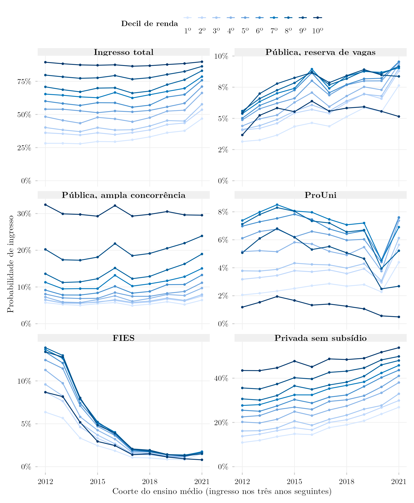
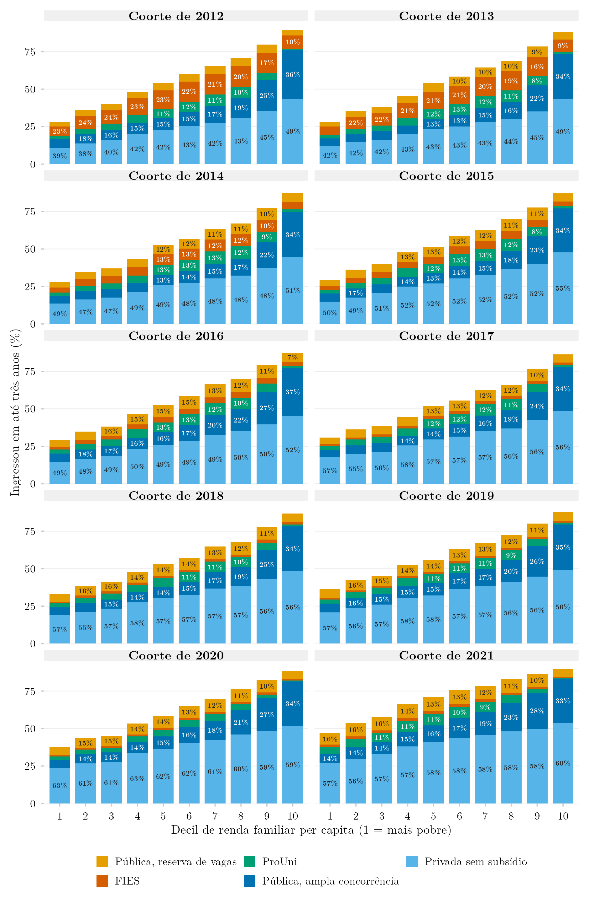
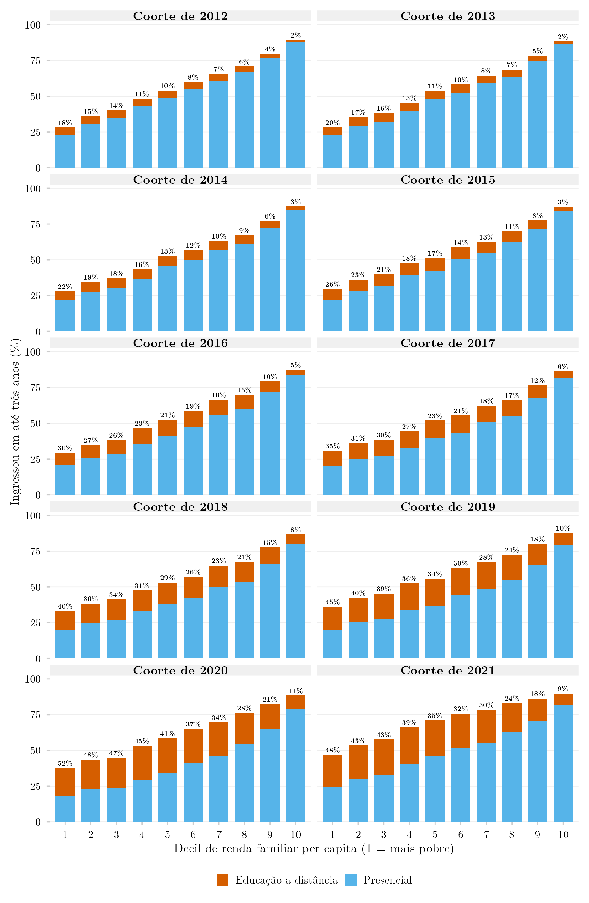
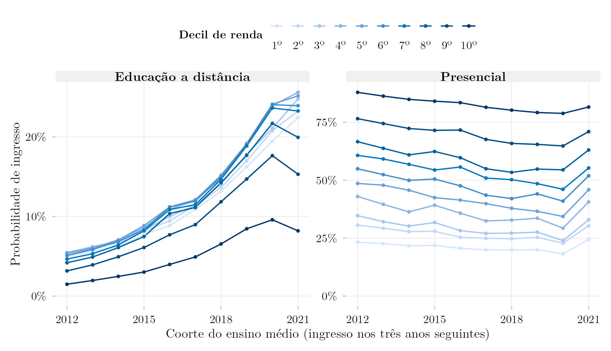
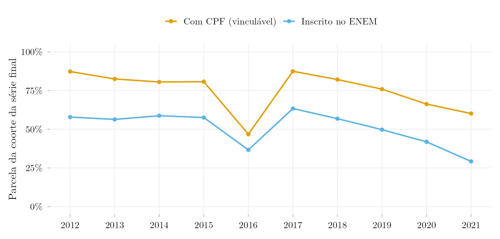

## Visão Geral

Este post estende a comparação de duas coortes de [Portas de Entrada por Decil de Renda per Capita](../portas-renda-coortes-empilhado/index.qmd) e de [Modalidade de Ensino](../portas-renda-coortes-ead/index.qmd) a todas as coortes do ensino médio que os registros vinculados permitem, de 2012 a 2021. Cada linha é um decil de renda; cada ponto é a probabilidade de que um estudante daquele decil e daquela coorte tenha ingressado no ensino superior nos três anos seguintes ao último ano escolar. O primeiro painel é o ingresso total; os outros cinco o dividem por porta: instituição pública por reserva de vaga, instituição pública por ampla concorrência, ProUni, FIES ou instituição privada sem subsídio.

Com os inscritos como denominador, o ingresso total no decil mais pobre sobe de 28,2% na coorte de 2012 para 36,2% em 2019 e 46,9% em 2021; no mais rico, permanece perto de 90%. O ingresso privado sem subsídio sobe de 10,9% para 26,9% no mais pobre e de 43,5% para 53,8% no mais rico. São probabilidades condicionais entre inscritos no ENEM com vínculo, e não taxas para toda a coorte escolar.

## Composição do ingresso, coorte a coorte

Os mesmos números no desenho dos posts de duas coortes: em cada coorte, cada barra é um decil de renda, sua altura é a probabilidade total de ingresso do decil, e os segmentos a dividem por porta; a porcentagem em cada segmento é a parcela daquela porta entre os ingressantes do decil (segmentos com menos de 6 pontos ficam sem rótulo).

Por modalidade, com a parcela da educação a distância entre os ingressantes do decil acima de cada barra:

## Modalidade

O ingresso a distância no decil mais pobre sobe de 5,0% (2012) para 16,2% (2019) e 22,4% (2021); no mais rico, de 1,5% para 8,5% e 8,2%. O ingresso presencial no decil mais pobre é de 23,3%, 20,0% e 24,4% nessas coortes.

## Cobertura

A população por trás de cada probabilidade reúne os estudantes da coorte escolar com CPF vinculável inscritos no ENEM daquele ano, inclusive ausentes. Eles representam 57,9% da coorte da série final em 2012, 49,8% em 2019, 41,8% em 2020 e 29,2% em 2021. A própria cobertura de CPF cai para 46,8% em 2016 e 60,2% em 2021. Inscrição e vínculo ainda selecionam quem é observado; os resultados não podem ser extrapolados diretamente para todos os estudantes do ensino médio.

## Metodologia

**Coorte e vínculo.** Cada coorte é todo estudante matriculado na última série do ensino médio no Censo Escolar do ano da coorte (`TP_ETAPA_ENSINO` em 27, 28, 29, 32, 33, 34, 37, 38), com 16 a 22 anos, vinculado por CPF mascarado ao ENEM do mesmo ano e ao Censo da Educação Superior dos três anos seguintes.

**Inscrição no ENEM.** O padrão é `POPULACAO=inscritos`, como nos posts de duas coortes. A renda é informada na inscrição, então os ausentes também têm faixa de renda. Exigir presença selecionaria por um comportamento associado ao ingresso posterior. `POPULACAO=presentes` permanece disponível como análise de sensibilidade, com pastas separadas para a extração e as figuras. As figuras e matrizes redistribuídas neste post agora usam os inscritos.

**Ingresso, porta e modalidade.** Conta como ingressante quem tem algum registro no Censo da Educação Superior com ano de ingresso nos três anos seguintes. Cada ingressante recebe uma porta por prioridade entre todos os seus registros: pública com reserva de vaga (`IN_RESERVA_VAGAS`), pública por ampla concorrência, ProUni, FIES, privada sem subsídio. A modalidade é EaD se algum registro na janela for a distância (`TP_MODALIDADE_ENSINO` = 2).

**Decis de renda.** Faixa de renda familiar declarada (dezessete faixas, pontos médios em salários mínimos) dividida pelo ponto médio do grupo de moradores declarado, como nos posts de duas coortes; os decis são cortados dentro de cada coorte, e as células na fronteira são divididas proporcionalmente. As questões de renda são `Q003`/`Q004` em 2012–2014 e `Q006`/`Q005` desde 2015, conferidas contra os dados pelo script de sondagem abaixo.

**Limites.**

- A coorte de 2011 fica de fora: a questão de renda do ENEM 2011 usa outro conjunto de onze faixas, cujos pontos médios não foram conferidos.
- `IN_RESERVA_VAGAS` e `IN_RESERVA_ETNICO` estão vazios no Censo da Educação Superior de 2024. As demais variáveis de reserva (escola pública, renda, deficiência, outra) estão preenchidas em 2024 e, em 2023, só aparecem preenchidas para ingressantes por reserva; por isso a reserva de vaga é identificada por `IN_RESERVA_VAGAS` = 1 ou `IN_RESERVA_ENSINO_PUBLICO` preenchido. A regra também recupera ingressantes por reserva registrados em 2024.
- Mudanças no ProUni e nas demais portas podem combinar alterações no acesso, na inscrição e no vínculo dos registros; os agregados não identificam uma explicação causal.
- Cursos a distância não exigem o ENEM; as figuras descrevem seus inscritos, inclusive ausentes, e não todos os ingressantes.
- As contagens trazem o ruído de privacidade diferencial da plataforma; a perda de linhas informada é de no máximo 2,3% por consulta (`data/row_loss.csv`).

## Reprodução

1. [`plot.R`](../../posts/portas-renda-coortes-anuais/plot.R) lê as tabelas agregadas em `data/` e grava as três figuras em inglês e português, mais `data/probabilidades_por_decil.csv`, com todos os valores desenhados, e `data/cobertura.csv`.
2. [`shared-pipeline/sedap/portas-anuais/010_Sondagem_Anual.R`](../../shared-pipeline/sedap/portas-anuais/010_Sondagem_Anual.R) confere, ano a ano, as variáveis de renda, moradores e presença do ENEM, a cobertura de CPF do Censo Escolar e as variáveis de porta e modalidade do Censo da Educação Superior (`data/sondagem_*.csv`).
3. [`shared-pipeline/sedap/portas-anuais/020_Extrair_Coortes_Anuais.R`](../../shared-pipeline/sedap/portas-anuais/020_Extrair_Coortes_Anuais.R) roda as duas consultas por coorte e grava `data-raw/sedap/portas-anuais/inscritos/matriz_<coorte>_porta.csv` e `matriz_<coorte>_modalidade.csv`. Os scripts de extração só rodam com credencial aprovada do INEP exportada como `SEDAP_TOKEN`.

O gráfico usa uma extração completa da população selecionada ou o snapshot redistribuído correspondente, identificado por `data/populacao.csv`. Ele recusa caches incompletos e populações divergentes. A execução padrão atualiza os agregados e figuras publicados dos inscritos. Uma análise com `POPULACAO=presentes` grava apenas em `output/figures/portas-renda-coortes-anuais/presentes/`.
