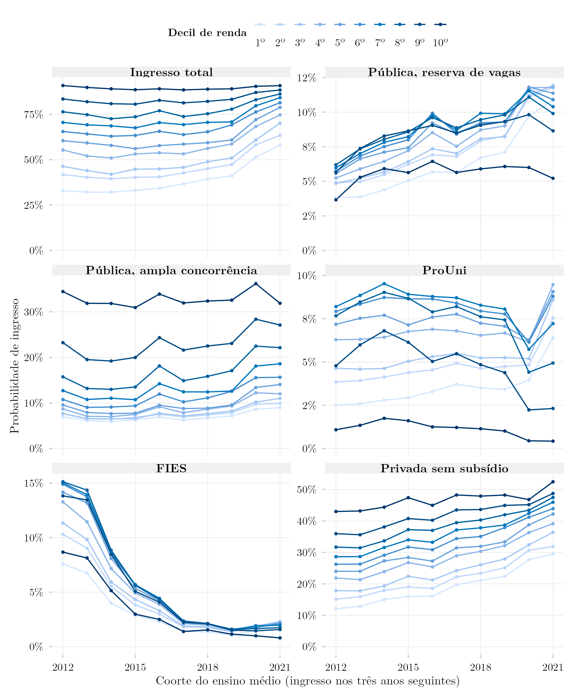
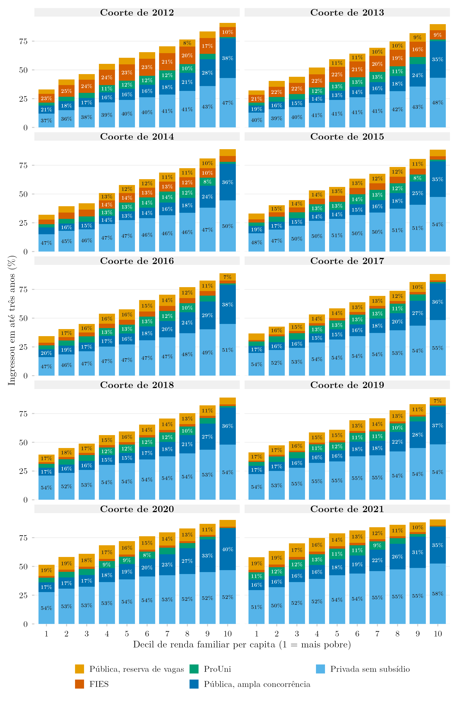
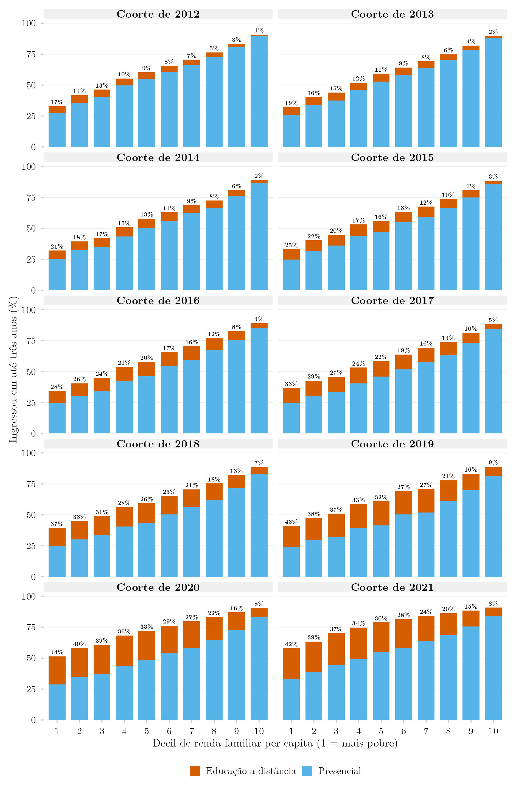
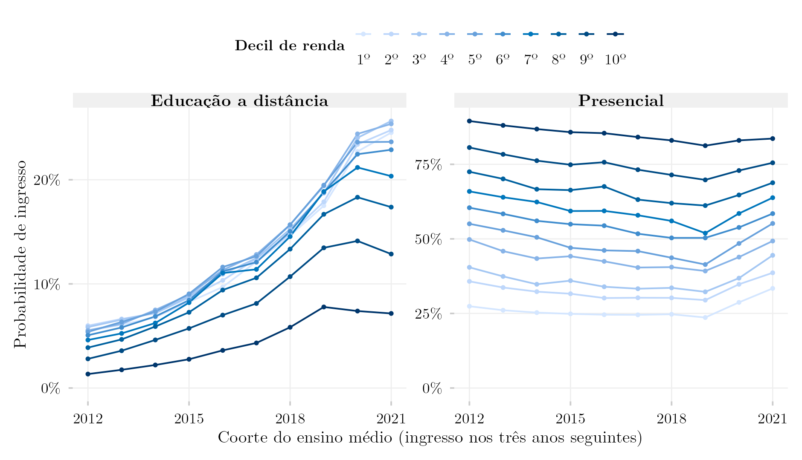
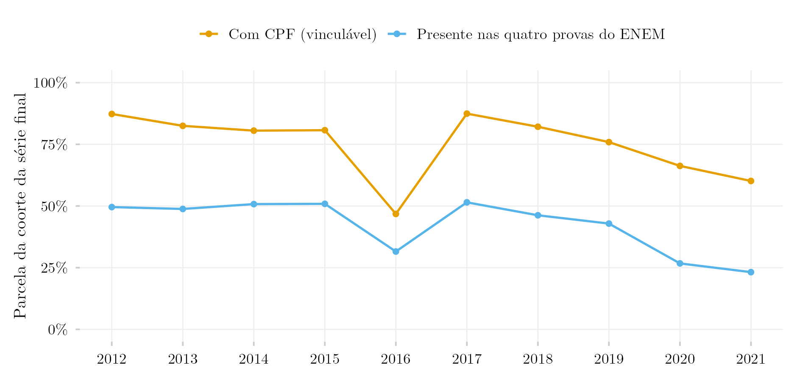

## Visão Geral

Este post estende a comparação de duas coortes de [Portas de Entrada por Decil de Renda per Capita](../portas-renda-coortes-empilhado/index.qmd) e de [Modalidade de Ensino](../portas-renda-coortes-ead/index.qmd) a todas as coortes do ensino médio que os registros vinculados permitem, de 2012 a 2021. Cada linha é um decil de renda; cada ponto é a probabilidade de que um estudante daquele decil e daquela coorte tenha ingressado no ensino superior nos três anos seguintes ao último ano escolar. O primeiro painel é o ingresso total; os outros cinco o dividem por porta: instituição pública por reserva de vaga, instituição pública por ampla concorrência, ProUni, FIES ou instituição privada sem subsídio.

Três movimentos se destacam. O FIES despenca entre as coortes de 2013 e 2015, de 7–15% de cada decil para 3–6%, e continua caindo. O ingresso privado sem subsídio sobe em todos os decis, de 12% para 30% no mais pobre e de 43% para 53% no mais rico entre as coortes de 2012 e 2021. E o ingresso total do decil mais pobre, estável em cerca de um terço até a coorte de 2016, sobe para 41% em 2019 e 58% em 2021, enquanto o decil mais rico fica perto de 90%. Essa última subida coincide com a queda da presença no ENEM nas edições da pandemia e não deve ser lida como mudança real sem levar em conta a figura de cobertura abaixo.

## Composição do ingresso, coorte a coorte

Os mesmos números no desenho dos posts de duas coortes: em cada coorte, cada barra é um decil de renda, sua altura é a probabilidade total de ingresso do decil, e os segmentos a dividem por porta; a porcentagem em cada segmento é a parcela daquela porta entre os ingressantes do decil (segmentos com menos de 6 pontos ficam sem rótulo).

Por modalidade, com a parcela da educação a distância entre os ingressantes do decil acima de cada barra:

## Modalidade

O ingresso em educação a distância sobe em todos os decis, mas muito mais rápido na base: no decil mais pobre, de 5,5% (coorte de 2012) para 17,5% (2019) e 24,5% (2021); no mais rico, de 1,3% para 7,8% e 7,2%. O ingresso presencial cai na maioria dos decis até a coorte de 2019 e se recupera depois, de novo nas coortes com menor cobertura do ENEM.

## Cobertura

A população por trás de cada probabilidade é a parte da coorte escolar que tem CPF vinculável e esteve presente nas quatro provas objetivas do ENEM do ano da coorte. Essa parte é cerca de metade da coorte da série final de 2012 a 2017 e cai para 43% (2019), 27% (2020) e 23% (2021). A coorte de 2016 é uma exceção dentro dos anos estáveis: só 47% dos seus estudantes da série final têm CPF no Censo Escolar, contra 81–87% nos anos vizinhos. Quando menos estudantes, e mais selecionados, fazem o ENEM, um decil da amostra restante é outro grupo de pessoas; as subidas das coortes de 2020 e 2021, em particular, misturam mudança no ingresso com mudança em quem é observado.

## Metodologia

**Coorte e vínculo.** Cada coorte é todo estudante matriculado na última série do ensino médio no Censo Escolar do ano da coorte (`TP_ETAPA_ENSINO` em 27, 28, 29, 32, 33, 34, 37, 38), com 16 a 22 anos, vinculado por CPF mascarado ao ENEM do mesmo ano e ao Censo da Educação Superior dos três anos seguintes.

**Presença no ENEM (novo).** Os posts anteriores, de duas coortes, vinculavam a coorte à *inscrição* no ENEM: as tabelas do ENEM têm uma linha por inscrito, inclusive quem faltou. A abstenção varia muito entre edições (29% faltaram à prova de matemática em 2012, 55% em 2020) e tem gradiente de renda, então uma série anual construída sobre a inscrição mudaria de população de um ano para o outro. Aqui o estudante só entra se esteve presente nas quatro provas objetivas (`IN_PRESENCA_*` até 2014, `TP_PRESENCA_*` desde 2015). Na coorte de 2013, isso reduz a população de 1.229.035 inscritos para 1.064.350 presentes.

**Ingresso, porta e modalidade.** Conta como ingressante quem tem algum registro no Censo da Educação Superior com ano de ingresso nos três anos seguintes. Cada ingressante recebe uma porta por prioridade entre todos os seus registros: pública com reserva de vaga (`IN_RESERVA_VAGAS`), pública por ampla concorrência, ProUni, FIES, privada sem subsídio. A modalidade é EaD se algum registro na janela for a distância (`TP_MODALIDADE_ENSINO` = 2).

**Decis de renda.** Faixa de renda familiar declarada (dezessete faixas, pontos médios em salários mínimos) dividida pelo ponto médio do grupo de moradores declarado, como nos posts de duas coortes; os decis são cortados dentro de cada coorte, e as células na fronteira são divididas proporcionalmente. As questões de renda são `Q003`/`Q004` em 2012–2014 e `Q006`/`Q005` desde 2015, conferidas contra os dados pelo script de sondagem abaixo.

**Limites.**

- A coorte de 2011 fica de fora: a questão de renda do ENEM 2011 usa outro conjunto de onze faixas, cujos pontos médios não foram conferidos.
- `IN_RESERVA_VAGAS` e `IN_RESERVA_ETNICO` estão vazios no Censo da Educação Superior de 2024. As demais variáveis de reserva (escola pública, renda, deficiência, outra) estão preenchidas em 2024 e, em 2023, só aparecem preenchidas para ingressantes por reserva; por isso a reserva de vaga é identificada por `IN_RESERVA_VAGAS` = 1 ou `IN_RESERVA_ENSINO_PUBLICO` preenchido. Até 2023 a regra é a mesma; em 2024 ela recupera os ingressantes por reserva da coorte de 2021, cuja parcela na coorte (10,3%) fica perto da coorte de 2020 (10,6%).
- O ingresso pelo ProUni da coorte de 2021 é maior que nas coortes vizinhas (6,5% da coorte, contra 4,5% em 2020, cerca de 40% mais bolsistas em números absolutos). A correção da reserva não o altera. Ainda não há explicação: a forte queda da presença no ENEM de 2021, que o ProUni exige, é uma candidata.
- Cursos a distância não exigem o ENEM, então as figuras descrevem quem fez o exame, não todos os ingressantes.
- As contagens trazem o ruído de privacidade diferencial da plataforma; a perda de linhas informada é de no máximo 2,3% por consulta (`data/row_loss.csv`).

## Reprodução

1. [`plot.R`](../../posts/portas-renda-coortes-anuais/plot.R) lê as tabelas agregadas em `data/` e grava as três figuras em inglês e português, mais `data/probabilidades_por_decil.csv`, com todos os valores desenhados, e `data/cobertura.csv`.
2. [`shared-pipeline/sedap/portas-anuais/010_Sondagem_Anual.R`](../../shared-pipeline/sedap/portas-anuais/010_Sondagem_Anual.R) confere, ano a ano, as variáveis de renda, moradores e presença do ENEM, a cobertura de CPF do Censo Escolar e as variáveis de porta e modalidade do Censo da Educação Superior (`data/sondagem_*.csv`).
3. [`shared-pipeline/sedap/portas-anuais/020_Extrair_Coortes_Anuais.R`](../../shared-pipeline/sedap/portas-anuais/020_Extrair_Coortes_Anuais.R) roda as duas consultas por coorte e grava `data/matriz_<coorte>_porta.csv` e `data/matriz_<coorte>_modalidade.csv`. Os scripts de extração só rodam com credencial aprovada do INEP exportada como `SEDAP_TOKEN`.
