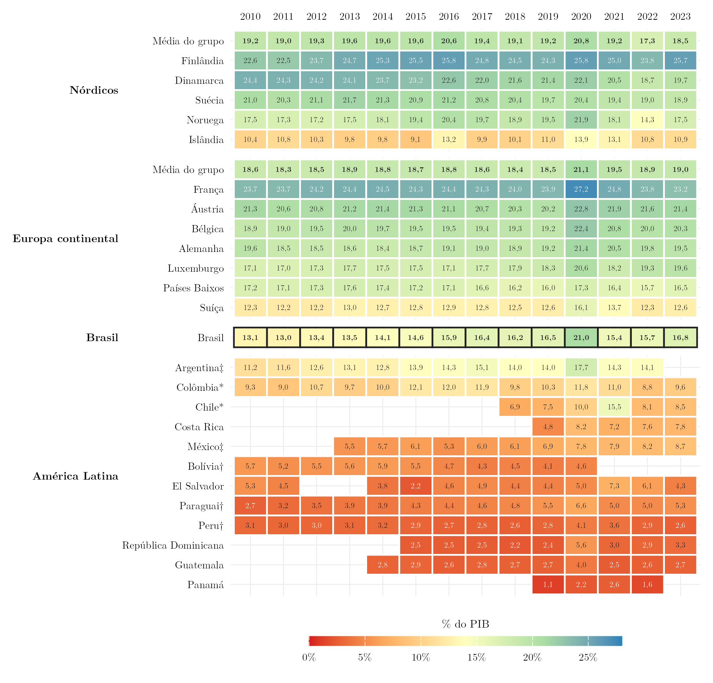

## Visão Geral

Esta figura compara o gasto do governo geral brasileiro em proteção social com o dos países nórdicos, da Europa continental e dos países latino-americanos com dados disponíveis, ano a ano, de 2010 a 2023. O Brasil passou de 13,1% do PIB em 2010 para 16,8% em 2023, com pico de 21,0% em 2020, primeiro ano da pandemia. Em 2023, a média nórdica foi de 18,5% e a da Europa continental, de 19,0%. Entre os latino-americanos, a Colômbia gastou 9,6%, o México 8,7% e o Chile 8,5% em 2023, e a Argentina, 14,1% em 2022.

## Metodologia

**A função.** Proteção social é a divisão 710 da Classificação das Funções de Governo (COFOG). Ela reúne doença e invalidez, velhice, pensão por morte, família e crianças, desemprego, habitação e exclusão social. No Brasil, inclui, portanto, tanto a previdência (RGPS e regimes próprios dos servidores) quanto os programas de assistência social.

**Cobertura de governo.** Os valores se referem ao governo geral (setor S13: governos central, estaduais e municipais e fundos de seguridade social), como proporção do PIB nominal. As exceções são a Argentina e o México, para os quais só existe o setor público não financeiro, que soma ao governo geral as empresas públicas não financeiras.

**Fontes.** A fonte principal são as Government Finance Statistics do FMI (dataflow `IMF.STA:GFS_COFOG`, transformação `POGDP_PT`). Chile e Colômbia não têm a série do governo geral para essa função nos dados do FMI; os valores vêm das contas nacionais da OCDE: Table 11 (`DSD_NASEC10@DF_TABLE11`, despesa total na função GF10, em moeda nacional) dividida pelo PIB nominal da Table 1 (`DSD_NAMAIN10@DF_TABLE1_EXPENDITURE`). Esses dois países levam asterisco. Como conferência, a mesma conta da OCDE para a França coincide com o valor do FMI em todos os anos de 2010 a 2023. Os países sem o dado no FMI nem na OCDE vêm da base de gasto social da CEPAL (CEPALSTAT, indicador 3127, divisão "Protección social"), compilada a partir dos ministérios da Fazenda de cada país: Paraguai, Bolívia e Peru, com o governo geral (†), e Argentina e México, com o setor público não financeiro (‡). Para o Brasil, o governo geral da CEPAL coincide com o do FMI (13,1% em 2010 e 21,0% em 2020).

**Grupos.** Nórdicos: Dinamarca, Finlândia, Islândia, Noruega e Suécia. Europa continental: Alemanha, Áustria, Bélgica, França, Luxemburgo, Países Baixos e Suíça. Os dois grupos europeus têm dados em todos os anos, e a linha de média é uma média simples. A América Latina não tem linha de média, porque o conjunto de países com dados muda de um ano para outro e a média mudaria de composição junto com ele.

**Limites.** Equador e Uruguai só têm o governo central, na CEPAL, e ficam de fora; células vazias indicam anos sem dado. A CEPAL avisa que nem todos os países usam o classificador COFOG das Nações Unidas e que o registro pode ser de caixa ou de competência, de modo que as séries marcadas com † e ‡ são menos comparáveis que as demais. Para a Costa Rica, FMI e OCDE divergem (2019: 4,8% no FMI, 7,8% na OCDE, 7,7% na CEPAL); a figura usa o FMI, como para os demais países. O gasto em proporção do PIB mede o esforço fiscal, e não a cobertura, o valor dos benefícios ou a sua distribuição.

## Como Citar

Se você usar esta figura ou o pipeline que a gera, cite tanto a dissertação quanto esta análise específica. As referências seguem a 7ª edição da APA.

**Dissertação (em elaboração; a entrada será atualizada após a defesa):**

> Mançano, T. (2026). *Inequality in access to tertiary education in Brazil: Household incomes, reforming policies, and the politics of who gets in (1990s–2020s)* [Dissertação de mestrado não publicada]. Universidade de São Paulo.

**Esta figura e o pipeline:**

> Mançano, T. (2026, 12 de novembro). *Gasto em proteção social: Brasil, Europa e América Latina* [Figura e pipeline reprodutível]. Open Data Analysis. https://mancano-tales.github.io/open-data-analysis/pt/posts-pt/protecao-social-brasil-europa-america-latina/

**No texto:** (Mançano, 2026) — ao citar várias análises deste catálogo no mesmo trabalho, a APA as distingue como 2026a, 2026b, … na ordem em que aparecem na lista de referências.

**BibTeX:**

```bibtex
@mastersthesis{Mancano2026Thesis,
  author = {Man\c{c}ano, Tales},
  title  = {Inequality in Access to Tertiary Education in Brazil: Household
            Incomes, Reforming Policies, and the Politics of Who Gets In
            (1990s--2020s)},
  school = {University of S\~{a}o Paulo},
  year   = {2026},
  type   = {Master's thesis},
  note   = {Unpublished; Graduate Program in Political Science}
}

@misc{Mancano2026_protecao_social_brasil_europa_america_latina_pt,
  author       = {Man\c{c}ano, Tales},
  title        = {Gasto em prote\c{c}\~{a}o social: Brasil, Europa e Am\'{e}rica Latina},
  year         = {2026},
  month        = nov,
  howpublished = {Open Data Analysis, \url{https://mancano-tales.github.io/open-data-analysis/pt/posts-pt/protecao-social-brasil-europa-america-latina/}},
  note         = {Figura e pipeline reprodutível. Código-fonte: \url{https://github.com/mancano-tales/open-data-analysis}, pasta posts/protecao-social-brasil-europa-america-latina/. Acesso em AAAA-MM-DD}
}
```

Uma versão permanente (tag do Git + DOI no Zenodo) será linkada aqui assim que a dissertação for defendida; até lá, cite a URL da página acima e acrescente a data de acesso (código-fonte: https://github.com/mancano-tales/open-data-analysis, pasta `posts/protecao-social-brasil-europa-america-latina/`).

## Pipeline

Scripts desta análise:

- Dados de origem: [`shared-pipeline/cofog/010_COFOG_Protecao_Social.R`](../../shared-pipeline/cofog/010_COFOG_Protecao_Social.R) — consulta as APIs SDMX do FMI e da OCDE e a API do CEPALSTAT e grava `data/protecao_social.csv`.
- Plotagem: [`plot.R`](../../posts/protecao-social-brasil-europa-america-latina/plot.R) — lê `data/` e grava `fig-en.png`, `fig-pt.png` e `thumbnail.png`.

## Reprodutibilidade

**Tier: A**

Este pipeline usa apenas dados públicos das APIs do FMI, da OCDE e da CEPAL, sem credencial. O CSV em `data/` basta para redesenhar a figura.
