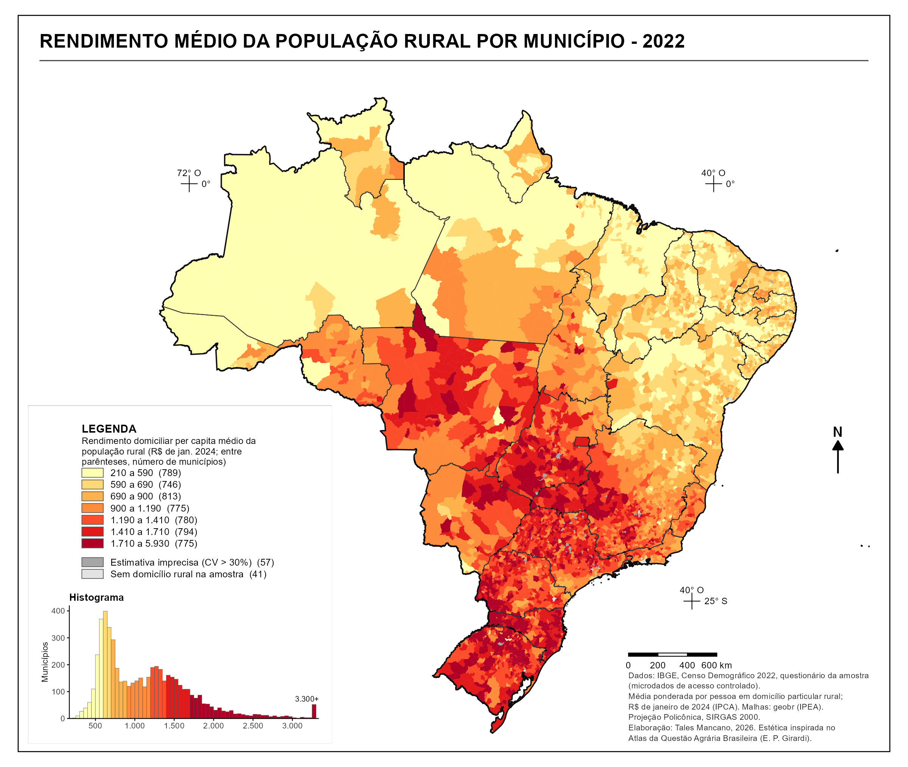

[Baixar os dados por município (CSV)](../../posts/renda-rural-municipio-2022/data/renda_rural_municipio_2022.csv){.btn .btn-outline-primary download="renda_rural_municipio_2022.csv"}

Uma linha por município com domicílio rural na amostra (5.529 linhas, UTF-8, separado por vírgulas, com ponto como separador decimal): código e nome, UF, região, tamanho da amostra, população rural estimada, média e mediana do rendimento per capita (em reais de janeiro de 2024 e nominais), erro-padrão, coeficiente de variação e proporção com renda zero. As colunas estão descritas em [Pipeline](#pipeline).

## Visão Geral

O mapa mostra, para cada município, o rendimento domiciliar per capita médio das pessoas que moram em domicílios rurais, segundo o questionário da amostra do Censo Demográfico 2022.
Os valores estão em reais de janeiro de 2024.
A população rural estimada é de 25,3 milhões de pessoas, com rendimento médio de R$ 910 por pessoa (R$ 864 em valores de julho de 2022).

A média regional, ponderada pela população rural, vai de R$ 612 no Norte e R$ 621 no Nordeste a R$ 1.180 no Sudeste, R$ 1.329 no Centro-Oeste e R$ 1.721 no Sul.
O Nordeste reúne 12,2 milhões dos 25,3 milhões de moradores rurais.
Cerca de um terço dos municípios do Norte (37%) e do Nordeste (34%) está na classe mais baixa do mapa, até R$ 590, enquanto 43% dos municípios do Sul estão na classe mais alta, acima de R$ 1.710.

A forma do mapa segue as convenções do *Atlas da Questão Agrária Brasileira*, de Eduardo Paulon Girardi (NERA/UNESP): moldura com título em caixa-alta, municípios sem contorno, paleta ordenada do amarelo ao vermelho-escuro, legenda com histograma da distribuição, cruzetas de coordenadas e projeção policônica.

## Metodologia

**Fonte.** Microdados da amostra do Censo Demográfico 2022 em acesso controlado, solicitados ao IBGE e lidos com `censobr::import_microdata22_controlado()`.
São 1,43 milhão de domicílios rurais e 4,19 milhões de pessoas na amostra.

**Definições.** O domicílio é rural quando `D0140` = 2 (povoado, núcleo rural, lugarejo ou área rural fora de aglomerados).
A renda é a `D0360`, rendimento domiciliar per capita calculado pelo próprio IBGE, que exclui os rendimentos de pensionistas, empregados domésticos e seus parentes.
A unidade de análise é a pessoa moradora de domicílio particular rural, exceto essas três condições e os moradores de domicílios coletivos (`P0170` 17–20, `P0130` = 6).
Cada pessoa recebe o rendimento per capita do seu domicílio, e a média municipal é ponderada pelo peso amostral `P0111`.
Domicílios com rendimento zero entram na média e reúnem 2,6% da população rural.
Os valores de julho de 2022 (data de referência do Censo) foram levados a janeiro de 2024 pelo IPCA (fator 1,0536).

**Classes.** Sete classes por quantis, arredondadas a dezenas de reais, calculadas sobre os municípios com estimativa aceitável.
Cada classe tem entre 746 e 813 municípios.

**Precisão.** O erro-padrão da média de cada município foi aproximado por linearização, com o domicílio como unidade primária de amostragem.
A aproximação ignora estratos e a calibração dos pesos por área de ponderação, e por isso tende a superestimar um pouco o erro.
Os 57 municípios em cinza médio têm coeficiente de variação acima de 30% (55) ou um único domicílio rural na amostra (2).
Os 41 em cinza claro não têm domicílio rural na amostra.
O coeficiente de variação mediano entre os municípios é de 7%.

**Média e mediana.** A média é sensível a poucas rendas altas, sobretudo em municípios com amostra rural pequena.
A tabela redistribuída traz também a mediana ponderada de cada município, o erro-padrão e o tamanho da amostra.

## Como Citar

Se você usar esta figura ou o pipeline que a gera, cite tanto a dissertação quanto esta análise específica. As referências seguem a 7ª edição da APA.

**Dissertação (em elaboração; a entrada será atualizada após a defesa):**

> Mançano, T. (2026). *Inequality in access to tertiary education in Brazil: Household incomes, reforming policies, and the politics of who gets in (1990s–2020s)* [Dissertação de mestrado não publicada]. Universidade de São Paulo.

**Esta figura e o pipeline:**

> Mançano, T. (2026, 11 de novembro). *Rendimento médio da população rural por município, 2022* [Figura e pipeline reprodutível]. Open Data Analysis. https://mancano-tales.github.io/open-data-analysis/pt/posts-pt/renda-rural-municipio-2022/

**No texto:** (Mançano, 2026) — ao citar várias análises deste catálogo no mesmo trabalho, a APA as distingue como 2026a, 2026b, … na ordem em que aparecem na lista de referências.

**BibTeX:**

```bibtex
@mastersthesis{Mancano2026Thesis,
  author = {Man\c{c}ano, Tales},
  title  = {Inequality in Access to Tertiary Education in Brazil: Household
            Incomes, Reforming Policies, and the Politics of Who Gets In
            (1990s--2020s)},
  school = {University of S\~{a}o Paulo},
  year   = {2026},
  type   = {Master's thesis},
  note   = {Unpublished; Graduate Program in Political Science}
}

@misc{Mancano2026_renda_rural_municipio_2022_pt,
  author       = {Man\c{c}ano, Tales},
  title        = {Rendimento m\'{e}dio da popula\c{c}\~{a}o rural por munic\'{\i}pio, 2022},
  year         = {2026},
  month        = nov,
  howpublished = {Open Data Analysis, \url{https://mancano-tales.github.io/open-data-analysis/pt/posts-pt/renda-rural-municipio-2022/}},
  note         = {Figura e pipeline reprodutível. Código-fonte: \url{https://github.com/mancano-tales/open-data-analysis}, pasta posts/renda-rural-municipio-2022/. Acesso em AAAA-MM-DD}
}
```

Uma versão permanente (tag do Git + DOI no Zenodo) será linkada aqui assim que a dissertação for defendida; até lá, cite a URL da página acima e acrescente a data de acesso (código-fonte: https://github.com/mancano-tales/open-data-analysis, pasta `posts/renda-rural-municipio-2022/`).

## Pipeline

A figura lê uma tabela agregada redistribuída na pasta [`data/`](../../posts/renda-rural-municipio-2022/data/) do post, [`renda_rural_municipio_2022.csv`](../../posts/renda-rural-municipio-2022/data/renda_rural_municipio_2022.csv), com uma linha por município que tem domicílio rural na amostra (5.529 linhas): código e nome do município, UF, região, tamanho da amostra, população rural estimada, média e mediana do rendimento per capita (em reais de janeiro de 2024 e nominais), erro-padrão, coeficiente de variação e proporção com renda zero.

1. [`plot.R`](../../posts/renda-rural-municipio-2022/plot.R) — junta a tabela à malha municipal do `geobr`, define as classes e grava `fig-pt.png`, `fig-en.png` e `thumbnail.png`.

Para recalcular a tabela a partir dos microdados (exige o zip de acesso controlado do IBGE já importado para o cache do `censobr`):

1. [`shared-pipeline/censo/050_Renda_Rural_Municipio_2022.R`](../../shared-pipeline/censo/050_Renda_Rural_Municipio_2022.R) — agrega os microdados por município e grava `data/renda_rural_municipio_2022.csv`.

## Reprodutibilidade

**Tier: B (agregado redistribuído)** — figura reprodutível sem credencial a partir da tabela agregada redistribuída; o recálculo exige os microdados de acesso controlado do Censo 2022.

A tabela não traz registro individual: cada linha é uma estatística municipal estimada sobre todos os moradores rurais da amostra no município.
Os microdados da amostra do Censo 2022 em acesso controlado são solicitados ao IBGE em https://microdados.ibge.gov.br/, e `censobr::import_microdata22_controlado()` (ramo de desenvolvimento do pacote, testado no commit `dd48725`) só processa um arquivo que o usuário já tem.
