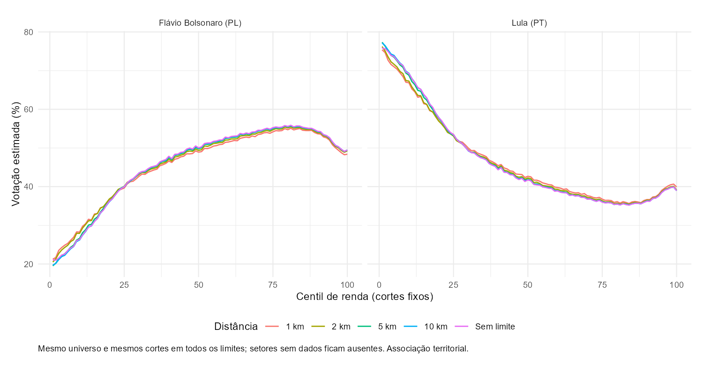
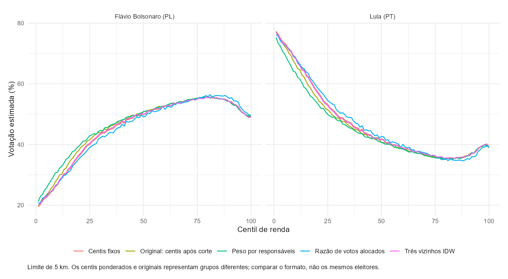
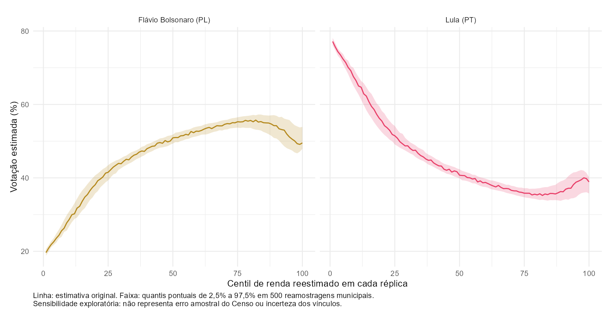

::: {.callout-warning}
**A renda é do setor censitário; o voto observado é do local de votação.**
O gráfico associa a renda média de setores à votação dos locais próximos.
Uma votação maior em setores de renda alta **não demonstra que eleitores
de renda alta votaram naquele candidato**. Não há renda individual dos
eleitores nem identificação de onde os moradores de cada setor votaram.
A proximidade espacial é uma aproximação e não identifica o eleitorado do setor.
:::

## Visão geral

Este post reconstrói a relação entre renda e votação presidencial apresentada
por Daniel Mariani, Paula Soprana e Nicholas Pretto na
[Folha de S.Paulo, em 12 de outubro de 2026](https://www1.folha.uol.com.br/poder/2026/10/flavio-bolsonaro-supera-votos-do-pai-em-todas-as-rendas-e-lula-cresce-entre-mais-ricos.shtml).
O eixo horizontal ordena setores censitários pela renda dos responsáveis pelos
domicílios; o vertical mostra a votação estimada em cada grupo de setores.

::: {.callout-note}
**Reprodução aproximada.** O cruzamento nacional e as verificações numéricas
foram executados com dados públicos. A regra espacial é uma implementação
própria: a reportagem não especifica todos os parâmetros da atribuição por
proximidade. As curvas calculadas apresentam diferenças em relação à imagem
de referência, e a escolha da distância máxima tem efeito relevante.
:::

## Resultados e cobertura

A estimativa principal, com limite de 5 km, inclui **410.010 setores** dos
458.772 presentes na tabela de renda (89,37%). Foram excluídos 9.241 sem
renda elegível, 39.483 por distância e 38 sem associação espacial disponível.
Os percentis têm 4.100 ou 4.101 setores cada.

No centil 46, Lula obtém **42,35%**, com renda média setorial de **1,68 salário
mínimo**; a imagem fornecida mostra 41,12% e 1,69. A diferença de votação é
de 1,23 ponto percentual. No centil 100, a estimativa é de 38,90% para Lula
e 49,53% para Flávio, com renda de 16,52 salários mínimos. Flávio passa a
superar Lula no centil 35 nesta implementação. Esses centis ordenam setores,
sem permitir concluir qual fração da população votou em cada candidato.

| Distância máxima | Setores incluídos |
|---|---:|
| 1 km | 326.951 |
| 2 km | 368.147 |
| 5 km (figura principal) | 410.010 |

Entre as curvas de 1 e 5 km, a maior diferença entre centis de mesmo número
é de 6,32 pontos percentuais para Lula e 5,51 para Flávio. As amostras e os
grupos de renda são recalculados em cada limite, de modo que essa diferença
combina cobertura e composição dos centis. A exclusão de setores distantes
dos locais de votação exige cuidado, especialmente na interpretação de áreas
rurais. A associação mostrada é territorial e descritiva.

A auditoria encontrou **6.588 divergências de local em 497.897 seções** entre
o arquivo de resultados e o cadastro atual do TSE. O cálculo usa o local
registrado nos resultados. Das 91.087 localizações com votos e coordenadas
utilizáveis, 818 foram excluídas por incompatibilidade com a malha municipal
de 2022; 90.269 locais permaneceram elegíveis à associação espacial.

Os [100 centis calculados](../../posts/votacao-renda-centil/data/centis.csv),
a [análise de sensibilidade](../../posts/votacao-renda-centil/data/sensibilidade.csv)
e os [registros de cobertura e proveniência](../../posts/votacao-renda-centil/data/README.md)
acompanham o post.

## Diagnósticos da auditoria



A [nota da verificação espacial](../../shared-pipeline/eleicoes/validacao/VERIFICACAO-ESPACIAL.md)
documenta a distorção da projeção nacional e a referência esférica independente
adotada para conferir os vínculos. As exclusões por incompatibilidade municipal
podem refletir geocodificação, cadastro ou mudanças na malha; o teste não
identifica a causa de cada divergência.

## Metodologia

A renda vem de `censobr::read_tracts(year = 2022,
dataset = "ResponsavelRenda")`. A variável `V06004` é o **valor do rendimento
nominal médio mensal das pessoas responsáveis com rendimentos por domicílios
particulares permanentes ocupados**. Não é renda domiciliar per capita nem
renda média de todos os moradores. `V06001` identifica o número de responsáveis,
incluindo aqueles sem rendimento; não é a quantidade de responsáveis com renda.
A tabela disponibilizada não informa essa última quantidade, portanto não
é possível calcular a proporção sem rendimento com essas variáveis.
Setores sem responsáveis ou com renda média ausente, sob sigilo ou não
positiva são excluídos.
O [dicionário oficial do IBGE](https://ftp.ibge.gov.br/Censos/Censo_Demografico_2022/Agregados_por_Setores_Censitarios_Rendimento_do_Responsavel/dicionario_de_dados_renda_responsavel_20260508.xlsx)
define as variáveis. Para exibir a renda em salários mínimos de 2022, divide-se
o valor nominal por R$ 1.212, salário mínimo de julho de 2022, referência do Censo.
A renda descreve os setores em 2022 e não mede a renda de seus moradores em
2026. Mudanças de composição, residência e renda entre os dois anos permanecem
fora do alcance deste cruzamento.

Os votos vêm do arquivo **Presidente — Votação por seção eleitoral — 2026**,
disponível em [Resultados 2026, no TSE](https://dadosabertos.tse.jus.br/dataset/resultados-2026).
Selecionam-se o primeiro turno e o cargo de presidente. O denominador contém
os votos válidos de **todos** os candidatos, excluindo brancos e nulos.
Essa classificação é conferida nas tabelas oficiais de candidatos e de
detalhe da votação por município e zona: um número de candidato no arquivo
bruto não garante que seus votos sejam válidos. Cada grupo precisa ser
integralmente válido ou integralmente excluído; uma validade parcial bloqueia
o cálculo, pois não se pode distribuí-la entre seções. Os registros sem
candidato correspondente precisam fechar exatamente com os nulos técnicos
oficiais em cada zona. Os totais válidos também precisam fechar em todas as zonas.
As duas curvas exibidas são Lula (PT) e Flávio Bolsonaro (PL); por isso,
não precisam somar 100%.

O pacote [`electionsBR`](https://github.com/silvadenisson/electionsBR) oferece
`vote_section()`, mas o código consultado documenta anos até 2024. Para 2026,
o pipeline consulta a API pública CKAN do TSE e baixa o ZIP oficial, evitando
depender de suporte ainda não confirmado do pacote. Os metadados e checksums
dos arquivos utilizados ficam junto ao cache em `data-raw/eleicoes-renda/`.

### Ligação espacial e interpretação

Uma seção eleitoral não é um setor censitário. A renda não deve ser anexada
aos votos por igualdade entre esses códigos. O próprio arquivo de resultados
identifica o local de cada seção. O cadastro de
[Eleitorado 2026, do TSE](https://dadosabertos.tse.jus.br/dataset/eleitorado-2026)
é usado para auditoria: se houver divergência, prevalece o código de local do
arquivo de votos, preservando a localização registrada na apuração. As
coordenadas são obtidas por
[`geobr::read_polling_places(year = 2026)`](https://ipea.github.io/geobr/reference/read_polling_places.html),
que combina coordenadas do TSE e geocodificação pelo `geocodebr`. Registros
repetidos com coordenadas idênticas são consolidados; locais com coordenadas
conflitantes são excluídos. Antes do uso, cada ponto precisa estar dentro da
malha de seu município, obtida com `geobr::read_municipality(year = 2022)`.

A versão independente usa o local de votação válido mais próximo do ponto
interno de cada setor, dentro do mesmo município e de uma distância máxima
configurável. Soma-se a votação das seções de cada local antes de calcular
os percentuais. Essa estimativa descreve a vizinhança eleitoral, não o voto
observado dos moradores do setor. A regra não reproduz necessariamente o
procedimento de geocodificação e interpolação usado pela Folha.

O endereço de cadastro eleitoral pode estar desatualizado ou diferir da
residência efetiva. Mesmo uma coordenada correta de local não informa a área
de residência de seus eleitores. Essa limitação permanece nas alternativas
de ponderação e interpolação e não é eliminada por aumentar a cobertura.

Os setores elegíveis são ordenados por renda, com código do setor como
desempate, e separados em 100 grupos com números de setores tão próximos
quanto possível. Cada setor tem o mesmo peso na média dos percentuais
eleitorais do grupo. Os centis não representam centésimos da população,
dos eleitores ou dos domicílios. O pipeline registra exclusões e compara
diferentes distâncias máximas.
A renda exibida para cada centil é a média simples das rendas médias
setoriais, em salários mínimos. Empates na distância entre locais são
resolvidos pela ordem do código composto de UF, município, zona e local.

## Sensibilidade e limitações

### O que muda nas análises de sensibilidade

A curva principal preserva a média simples dos percentuais atribuídos aos
setores, com centis recalculados depois do corte de distância. Um mesmo local
pode representar vários setores; portanto essa média não equivale à proporção
nacional de votos. A comparação por **cortes fixos** mantém o universo dos
setores com renda elegível e alguma ligação espacial, mesmo além de 5 km,
e define os centis uma única vez. Compara limites de 1, 2, 5 e 10 km e sem
limite; a quantidade de setores efetivamente observados acompanha cada grupo.

A alternativa **ponderada por responsáveis** ordena pela mesma renda e cria
os grupos pelo acumulado de `V06001` antes de cada setor. Nenhum setor é
dividido entre grupos, de modo que não há exatamente 1% dos responsáveis em
cada centil. Renda e votação são médias ponderadas por essa contagem, que
inclui responsáveis sem renda. Esse peso não é o número de eleitores.
Também não recupera a renda média individual agregada: não se conhece a
quantidade de responsáveis com rendimento em cada setor.

A **razão de votos alocados** distribui uma única vez os votos de cada local
entre os setores elegíveis ligados a ele, proporcionalmente a `V06001`,
e divide a soma de votos do candidato pela soma de válidos de cada grupo.
Os totais dos locais utilizados são conservados, mas a distribuição entre
setores é uma hipótese de alocação, não uma observação dos votos de moradores.

A alternativa espacial usa até **três locais próximos do mesmo município**,
com pesos inversamente proporcionais à distância e restritos ao limite
adotado. Entre os até três selecionados, se há distância zero, somente os
locais coincidentes recebem peso, dividido igualmente. A comparação mantém os mesmos grupos de renda. Usar
três vizinhos testa a regra de interpolação; não identifica onde os moradores
efetivamente votam.

As bandas da reamostragem municipal vêm de 500 réplicas com semente fixa:
sorteiam-se municípios com reposição, mantêm-se todos os seus setores e
recalculam-se os centis. Os quantis de 2,5% e 97,5% são **bandas exploratórias
pontuais**, sem interpretação de erro amostral do Censo ou de incerteza da
ligação espacial. O primeiro centil de superação é a primeira ocorrência;
não exige que o candidato permaneça à frente nos centis seguintes.

A comparação com a Folha usa sete posições da imagem fornecida, com leituras
visuais arredondadas e tolerância de leitura declarada de 1,5 ponto percentual.
Essa tolerância não é um intervalo estatístico. O único valor textual exato
é o tooltip de Lula no centil 46; a curva encoberta permanece sem valor.
Não se dispõe da base original da reportagem. A figura deste post é sempre
calculada a partir do TSE e do IBGE, sem traçar a imagem de referência.

## Pipeline

Execute a partir da raiz do repositório:

1. [`010_Download_Censo_TSE.R`](../../shared-pipeline/eleicoes/010_Download_Censo_TSE.R)
   — obtém renda setorial via `censobr`, votos presidenciais e locais de 2026
   pela API pública do TSE, com cache e registro das fontes.
2. [`020_Cruzar_Setores_Votos.R`](../../shared-pipeline/eleicoes/020_Cruzar_Setores_Votos.R)
   — obtém malhas e locais via `geobr`, valida as chaves, associa locais e setores, documenta exclusões e produz
   `data-raw/eleicoes-renda/centis.csv`.
3. [`030_Verificar_Resultados.R`](../../shared-pipeline/eleicoes/030_Verificar_Resultados.R)
   — confere os percentuais, os 100 centis, as contagens e as médias usando
   cálculos independentes em R base; refaz as geometrias de 2.000 setores e
   confere os três vizinhos sem usar os pontos internos salvos pelo estimador.
4. [`040_Preparar_Post.R`](../../shared-pipeline/eleicoes/040_Preparar_Post.R)
   — verifica o certificado e os hashes do `030`, prepara os resultados agregados
   do post e gera os diagnósticos em português e inglês.
5. [`plot.R`](../../posts/votacao-renda-centil/plot.R)
   — gera PNG e PDF em `output/figures/votacao-renda-centil/`.

O gráfico usa linhas sem suavização, eixo de renda no topo, cores próximas à
referência e rótulos diretos. O valor de 41,12% no centil 46 e a renda de
1,69 salário mínimo, visíveis na imagem de referência, são pontos de
comparação; não são constantes inseridas na série calculada.

O limite padrão de distância é de 5 km. Para recalcular os centis com outro
limite, defina `VOTOS_MAX_DIST_M` em metros antes de rodar o script `020`.
`sensibilidade.csv` contém as curvas sob limites de 1, 2 e 5 km, além do
limite escolhido. O cruzamento nacional baixa malhas detalhadas e pode levar
tempo e consumir alguns gigabytes de memória; os insumos ficam em cache.
As três etapas de dados também estão incluídas em
[`build_public_data.R`](../../shared-pipeline/build_public_data.R).

## Reprodutibilidade

**Tier: A — fontes públicas.** A execução nacional passou nas verificações
independentes dos percentuais por local, dos denominadores de votos válidos,
dos 100 centis, das contagens, das médias e das unidades de renda. O post
permanece como rascunho editorial, com a aproximação espacial e sua sensibilidade
explicitadas. Não há credencial nem dado individual identificável no produto
agregado.

Para redesenhar a figura sem os downloads upstream, execute apenas `plot.R`:
o script usa o snapshot agregado em `posts/votacao-renda-centil/data/` quando
não encontra uma versão recalculada em `data-raw/eleicoes-renda/`. As versões
dos pacotes e os hashes dos insumos acompanham esse snapshot.

## Como citar

> Mançano, T. (2026, 14 de outubro). *Votação presidencial por centil de renda
> dos setores censitários* [Figura e pipeline de reprodução aproximada]. Open Data Analysis.

A análise original é de Mariani, Soprana e Pretto (Folha de S.Paulo, 2026).
Esta implementação independente deve ser citada separadamente e não implica
validação pelos autores da reportagem.
