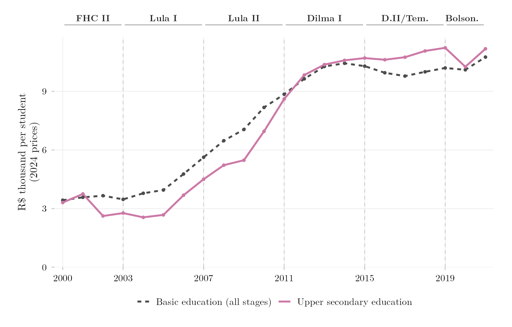

## Overview

This figure tracks how much the Brazilian state, adding up the federal, state and municipal governments, spent directly per student in basic education and in upper secondary education. In real terms, spending per student in basic education roughly tripled between 2000 and 2014, as did spending per upper secondary student, and grew little after 2014. Spending per upper secondary student fell in the early 2000s, when the Fundef funding rules favored primary education, and caught up with the average of basic education around 2011.

## Methodology

**Source.** INEP, *Indicadores Financeiros Educacionais*, spreadsheet `Investimento_estudante_valor_nominal.xlsx` (version of 10 September 2024), with spending per student by stage of education in current reais, 2000–2021.

**Concept.** Direct public spending covers active staff, other current expenditure and capital investment by the three levels of government. It excludes retirement pensions, scholarships, student loans, debt service and transfers to the private sector.

**Deflator.** Nominal values are deflated by the annual average of the IPCA (*Índice Nacional de Preços ao Consumidor Amplo*, IBGE's broad consumer price index, SIDRA table 1737) to 2024 prices. INEP also publishes a "real value" spreadsheet, but its editions use different price bases (2018 and 2021), so the nominal series is deflated here with a single deflator.

Government labels indicate the president in office.

## How to Cite

If you use this figure or the pipeline behind it, please cite both the dissertation and this specific analysis. References follow APA 7th edition.

**Dissertation (in preparation; the entry will be updated after the defense):**

> Mançano, T. (2026). *Inequality in access to tertiary education in Brazil: Household incomes, reforming policies, and the politics of who gets in (1990s–2020s)* [Unpublished master's thesis]. University of São Paulo.

**This figure and pipeline:**

> Mançano, T. (2026, November 14). *Public spending per student in basic education, Brazil 2000–2021* [Figure and reproducible pipeline]. Open Data Analysis. https://mancano-tales.github.io/open-data-analysis/posts/gasto-estudante-educacao-basica/

**In text:** (Mançano, 2026) — when citing several analyses from this catalog in the same work, APA distinguishes them as 2026a, 2026b, … in the order they appear in the reference list.

**BibTeX:**

```bibtex
@mastersthesis{Mancano2026Thesis,
  author = {Man\c{c}ano, Tales},
  title  = {Inequality in Access to Tertiary Education in Brazil: Household
            Incomes, Reforming Policies, and the Politics of Who Gets In
            (1990s--2020s)},
  school = {University of S\~{a}o Paulo},
  year   = {2026},
  type   = {Master's thesis},
  note   = {Unpublished; Graduate Program in Political Science}
}

@misc{Mancano2026_gasto_estudante_educacao_basica,
  author       = {Man\c{c}ano, Tales},
  title        = {Public spending per student in basic education, Brazil 2000--2021},
  year         = {2026},
  month        = nov,
  howpublished = {Open Data Analysis, \url{https://mancano-tales.github.io/open-data-analysis/posts/gasto-estudante-educacao-basica/}},
  note         = {Figure and reproducible pipeline. Source code: \url{https://github.com/mancano-tales/open-data-analysis}, folder posts/gasto-estudante-educacao-basica/. Accessed YYYY-MM-DD}
}
```

A permanent version (Git tag + Zenodo DOI) will be linked here once the dissertation is defended; until then, cite the page URL above and add the date you accessed it (source code: https://github.com/mancano-tales/open-data-analysis, folder `posts/gasto-estudante-educacao-basica/`).

## Pipeline

Scripts for this analysis:

- Plotting: [`plot.R`](plot.R) — reads `data/` and writes `fig-en.png`, `fig-pt.png` and `thumbnail.png`.
- Data: [`shared-pipeline/gasto-educacao-basica/010_INEP_Investimento_Estudante.R`](../../shared-pipeline/gasto-educacao-basica/010_INEP_Investimento_Estudante.R) downloads INEP's spreadsheet ([INEP financial indicators](https://www.gov.br/inep/pt-br/acesso-a-informacao/dados-abertos/indicadores-educacionais/indicadores-financeiros-educacionais)) and the IPCA from SIDRA table 1737, and writes the two files in `data/`. The spreadsheet matches the md5 checksum INEP publishes with it.

## Reproducibility

**Tier: A**

This pipeline uses only public data, accessible without any credential. The two CSV files in `data/` are enough to redraw the figure.
