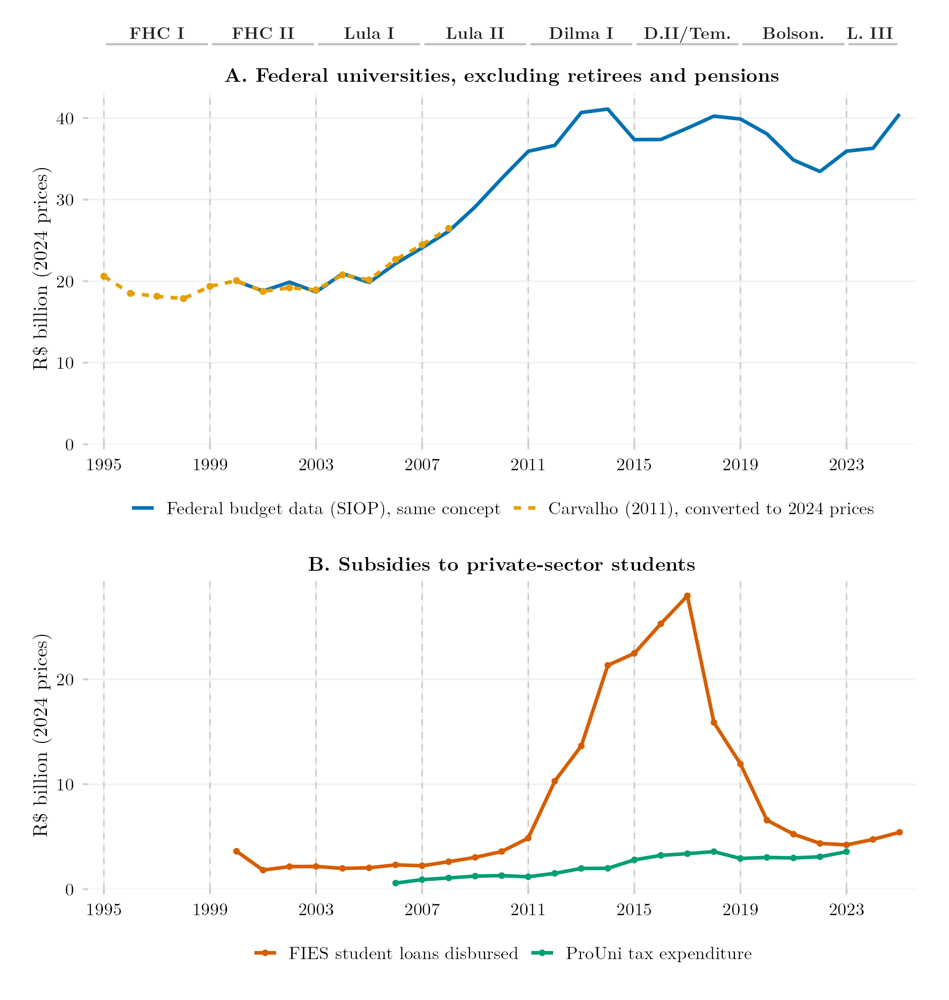

## Overview

This figure compares the two ways the federal government pays for tertiary education in Brazil: by funding its own universities, which are tuition-free, and by subsidizing students in private institutions. Spending on federal universities, excluding retirees and pensions, roughly doubled between 2003 and 2014 and has since fluctuated below that peak. Disbursements of FIES student loans rose from about R$ 5 billion in 2011 to almost R$ 28 billion in 2017, at 2024 prices, and fell back to about R$ 4 billion by 2022, while the tax expenditure of ProUni never exceeded R$ 4 billion a year.

## Methodology

**Panel A, federal universities.** Spending by the budget units of federal universities, excluding retirees and pensions, court-ordered payments, the employer pension contribution recorded in the budget since 2006 and staff benefits, following the concept of Carvalho (2011, Table VII). From 2000 to 2025 the series is built from executed (*liquidado*) spending in the federal budget, retrieved from the SIOP open data through its public SPARQL endpoint in October 2026. For 1995–2008 the figure also shows Carvalho's own series, converted from 2008 to 2024 prices with the same deflator; the two overlap in 2000–2008.

**Panel B, subsidies to private-sector students.** FIES: executed spending on new and ongoing loan disbursements (budget actions 0579 and 00IG), excluding the administration of the fund and payments into guarantee funds. ProUni: the tax expenditure from the federal taxes waived for participating institutions (IRPJ, CSLL, PIS-Pasep and Cofins), taken from the Federal Revenue Service's *Demonstrativo dos Gastos Tributários – Bases Efetivas*, using for each year the edition of that same year (2006–2023).

**Deflator.** Annual average of the IPCA (*Índice Nacional de Preços ao Consumidor Amplo*, IBGE's broad consumer price index, SIDRA table 1737), 2024 prices. Government labels indicate the president in office.

## How to Cite

If you use this figure or the pipeline behind it, please cite both the dissertation and this specific analysis. References follow APA 7th edition.

**Dissertation (in preparation; the entry will be updated after the defense):**

> Mançano, T. (2026). *Inequality in access to tertiary education in Brazil: Household incomes, reforming policies, and the politics of who gets in (1990s–2020s)* [Unpublished master's thesis]. University of São Paulo.

**This figure and pipeline:**

> Mançano, T. (2026, November 14). *Federal spending on universities and on private-sector students, Brazil 1995–2025* [Figure and reproducible pipeline]. Open Data Analysis. https://mancano-tales.github.io/open-data-analysis/posts/gasto-federal-educacao-superior/

**In text:** (Mançano, 2026) — when citing several analyses from this catalog in the same work, APA distinguishes them as 2026a, 2026b, … in the order they appear in the reference list.

**BibTeX:**

```bibtex
@mastersthesis{Mancano2026Thesis,
  author = {Man\c{c}ano, Tales},
  title  = {Inequality in Access to Tertiary Education in Brazil: Household
            Incomes, Reforming Policies, and the Politics of Who Gets In
            (1990s--2020s)},
  school = {University of S\~{a}o Paulo},
  year   = {2026},
  type   = {Master's thesis},
  note   = {Unpublished; Graduate Program in Political Science}
}

@misc{Mancano2026_gasto_federal_educacao_superior,
  author       = {Man\c{c}ano, Tales},
  title        = {Federal spending on universities and on private-sector students, Brazil 1995--2025},
  year         = {2026},
  month        = nov,
  howpublished = {Open Data Analysis, \url{https://mancano-tales.github.io/open-data-analysis/posts/gasto-federal-educacao-superior/}},
  note         = {Figure and reproducible pipeline. Source code: \url{https://github.com/mancano-tales/open-data-analysis}, folder posts/gasto-federal-educacao-superior/. Accessed YYYY-MM-DD}
}
```

A permanent version (Git tag + Zenodo DOI) will be linked here once the dissertation is defended; until then, cite the page URL above and add the date you accessed it (source code: https://github.com/mancano-tales/open-data-analysis, folder `posts/gasto-federal-educacao-superior/`).

## Pipeline

Run these scripts in this order, from the project root (each one writes to `data-raw/gasto-federal/`, which the next one reads):

1. [`shared-pipeline/gasto-federal/010_Coleta_SIOP_Execucao.R`](../../shared-pipeline/gasto-federal/010_Coleta_SIOP_Execucao.R) — queries the public SPARQL endpoint of the federal budget open data (SIOP) and saves, for each year from 2000 to 2025, the budget execution of every Ministry of Education unit and of the FIES unit by action and expenditure group; takes 20 to 40 minutes
2. [`shared-pipeline/gasto-federal/015_Download_RFB_Gastos_Tributarios.R`](../../shared-pipeline/gasto-federal/015_Download_RFB_Gastos_Tributarios.R) — downloads the 2008–2023 editions of the Federal Revenue Service's *Demonstrativo dos Gastos Tributários – Bases Efetivas* (about 33 MB)
3. [`shared-pipeline/gasto-federal/020_ProUni_Renuncia_RFB.R`](../../shared-pipeline/gasto-federal/020_ProUni_Renuncia_RFB.R) — reads the ProUni tax expenditure from the spreadsheet editions (2016–2023) and from the documented transcription of the PDF editions (2008–2015), [`prouni_transcricao_pdf.csv`](../../shared-pipeline/gasto-federal/prouni_transcricao_pdf.csv), with page and table for each value
4. [`shared-pipeline/gasto-federal/030_Monta_Series_Gasto.R`](../../shared-pipeline/gasto-federal/030_Monta_Series_Gasto.R) — assembles the annual series, deflates them by the IPCA from SIDRA and writes this post's `data/` files
5. [`plot.R`](plot.R) — reads `data/` and writes `fig-en.png`, `fig-pt.png` and `thumbnail.png`. Carvalho's (2011) Table VII values are typed into the script.

The SIOP updates recent years, so a new collection may differ from the one used here (10 October 2026) in the last years of the series.

## Reproducibility

**Tier: A**

This pipeline uses only public data, accessible without any credential. The two CSV files in `data/` are enough to redraw the figure without running the collection.

**Reference:** Carvalho, H. A. de (2011). *A política pública para a educação superior no Brasil (1995–2008): Ruptura e/ou continuidade?* [Doctoral dissertation, Universidade Estadual de Campinas]. https://doi.org/10.47749/T/UNICAMP.2011.784998 — Table VII, p. 331.

Download the aggregates: [gasto_federal_es_anual.csv](data/gasto_federal_es_anual.csv) · [ipca_media_anual.csv](data/ipca_media_anual.csv).
