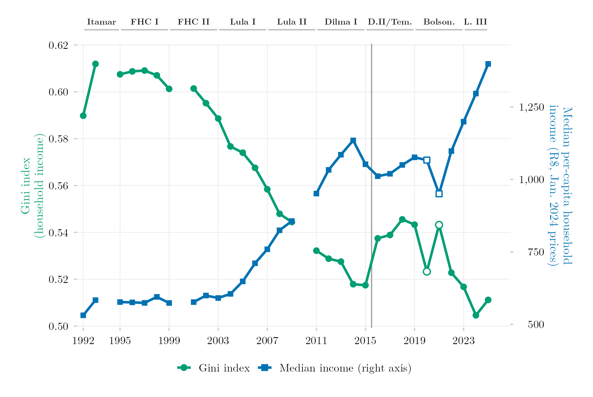

## Overview

This figure places the two income series that matter most for the trajectory of access to tertiary education in Brazil on a shared time axis: how unequal household income is (the Gini index, left axis) and how much income the household in the middle of the distribution has (the median real per-capita household income, right axis). The Gini index stayed close to its peak in the 1990s, fell steadily from 2001 to 2015, rose between 2016 and 2018 and fell again from 2022 to the lowest level of the series. Median income stagnated in the 1990s and early 2000s, almost doubled between 2003 and 2014, fell from 2015 to 2021 and recovered to its historical peak in 2025.

## Methodology

**Gini index.** Per-capita household income in the official universe, which retains households reporting no income, as IBGE does. The series reproduces IBGE's published Gini (mean deviation −0.0001) and is the same as panel A of the [Gini/Palma panel](../desigualdade-renda-gini-palma-decil/).

**Median income.** Weighted median of real per-capita household income for the whole population, deflated by the IPCA (*Índice Nacional de Preços ao Consumidor Amplo*, IBGE's broad consumer price index) to January 2024 prices. Income is measured per capita within the household throughout, and households reporting no income are retained. The series is the same as in the [median income post](../renda-mediana-domiciliar-pc/).

**Breaks and markers.** The lines are interrupted in 1994, 2000 and 2010, years without a PNAD. Hollow markers for 2020 and 2021 come from the fifth visit of the PNAD Contínua, collected mostly by telephone, which under-records the incomes of the poorest. The vertical rule marks the change from PNAD to PNAD Contínua in 2016; it is not rescaled away. In the 2012–2015 overlap, the PNAD Contínua gives a Gini higher by about 0.008, roughly a third of the step observed between 2015 and 2016. The right axis is scaled so that both series span the same vertical range; the crossing of the lines has no meaning of its own. Government labels indicate the president in office.

## How to Cite

If you use this figure or the pipeline behind it, please cite both the dissertation and this specific analysis. References follow APA 7th edition.

**Dissertation (in preparation; the entry will be updated after the defense):**

> Mançano, T. (2026). *Inequality in access to tertiary education in Brazil: Household incomes, reforming policies, and the politics of who gets in (1990s–2020s)* [Unpublished master's thesis]. University of São Paulo.

**This figure and pipeline:**

> Mançano, T. (2026, November 14). *Gini index and median household income, Brazil 1992–2025* [Figure and reproducible pipeline]. Open Data Analysis. https://mancano-tales.github.io/open-data-analysis/posts/gini-renda-mediana/

**In text:** (Mançano, 2026) — when citing several analyses from this catalog in the same work, APA distinguishes them as 2026a, 2026b, … in the order they appear in the reference list.

**BibTeX:**

```bibtex
@mastersthesis{Mancano2026Thesis,
  author = {Man\c{c}ano, Tales},
  title  = {Inequality in Access to Tertiary Education in Brazil: Household
            Incomes, Reforming Policies, and the Politics of Who Gets In
            (1990s--2020s)},
  school = {University of S\~{a}o Paulo},
  year   = {2026},
  type   = {Master's thesis},
  note   = {Unpublished; Graduate Program in Political Science}
}

@misc{Mancano2026_gini_renda_mediana,
  author       = {Man\c{c}ano, Tales},
  title        = {Gini index and median household income, Brazil 1992--2025},
  year         = {2026},
  month        = nov,
  howpublished = {Open Data Analysis, \url{https://mancano-tales.github.io/open-data-analysis/posts/gini-renda-mediana/}},
  note         = {Figure and reproducible pipeline. Source code: \url{https://github.com/mancano-tales/open-data-analysis}, folder posts/gini-renda-mediana/. Accessed YYYY-MM-DD}
}
```

A permanent version (Git tag + Zenodo DOI) will be linked here once the dissertation is defended; until then, cite the page URL above and add the date you accessed it (source code: https://github.com/mancano-tales/open-data-analysis, folder `posts/gini-renda-mediana/`).

## Pipeline

Scripts for this analysis:

- Plotting: [`plot.R`](plot.R) — reads `data/` and writes `fig-en.png`, `fig-pt.png` and `thumbnail.png`.
- Upstream data: `data/gini_oficial_anual.csv` comes from [`shared-pipeline/pnadc/238_Serie_Desigualdade_Oficial.R`](../../shared-pipeline/pnadc/238_Serie_Desigualdade_Oficial.R) (see the [Gini/Palma panel](../desigualdade-renda-gini-palma-decil/) for the scripts it needs), and `data/renda_mediana_anual.csv` from the pipeline of the [median income post](../renda-mediana-domiciliar-pc/).

## Reproducibility

**Tier: A**

This pipeline uses only public data, accessible without any credential (PNADcIBGE and the IBGE FTP). The two CSV files in `data/` are enough to redraw the figure.

Download the aggregates: [gini_oficial_anual.csv](data/gini_oficial_anual.csv) · [renda_mediana_anual.csv](data/renda_mediana_anual.csv).
