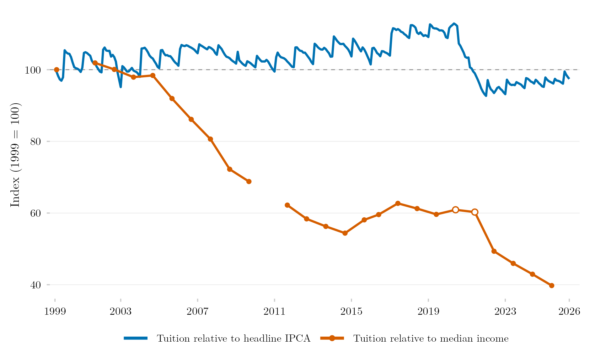

## Overview

This figure tracks how higher-education tuition in Brazil moved since 1999 against two benchmarks: overall consumer prices and the median per-capita household income. Relative to median income, tuition fell to about 40% of its 1999 level by 2025. Most of the decline came between 2004 and 2014 and after 2021. It complements the [version with the minimum wage](../ipca-mensalidade-curso-superior/).

## Methodology

**The subitem.** The tuition index is IPCA subitem 8101005, named `Curso terceiro grau` in 1999–2006 and `Ensino superior` afterwards. It belongs to the item Cursos regulares, alongside daycare, preschool, primary and secondary schooling, graduate courses, adult education and technical courses, each with its own subitem. The series splices SIDRA tables 655, 2938, 1419 and 7060 and accumulates monthly changes from August 1999.

**Price collection.** According to [IBGE's current methods manual](https://biblioteca.ibge.gov.br/visualizacao/livros/liv101767.pdf) (8th ed., 2020), the price is the semester fee at formal education establishments, including mandatory fees and excluding discounts. Prices are surveyed at the start of each semester, usually enter the February and March and the August and September indices, and are generally repeated until the next survey. The subitem's change in each area combines the ratio of average prices across establishments (Dutot) and the geometric mean across products (Jevons).

**Coverage.** The IPCA follows families earning 1 to 40 minimum wages in urban areas: 16 areas today, after Campo Grande and Vitória joined in January 2014, and Rio Branco, São Luís and Aracaju in May 2018.

**The two series.** The blue series deflates the tuition index by the headline IPCA, with August 1999 = 100. The orange series divides the tuition index by nominal median per-capita household income. Income is observed only in survey years, so each point compares the two in the survey's reference month (September in PNAD, June in PNAD Contínua), and both equal 100 in September 1999. The line breaks in 2000 and 2010, years without a survey. Hollow markers for 2020 and 2021 come from the fifth visit of PNAD Contínua. The change of survey in 2015–2016 is not rescaled: using PNAD Contínua for 2012–2014, when both surveys exist, would raise the index by 2.3 to 3.4 points.

**Limits.** The index measures price changes, not the price level or the average market fee. Because it follows the same products over time, it does not measure declines in the average fee that come from changes in the composition of supply. IBGE's manuals do not publish the list of courses and establishments in the sample, nor do they say whether distance-learning courses are part of it.

## How to Cite

If you use this figure or the pipeline behind it, please cite both the dissertation and this specific analysis. References follow APA 7th edition.

**Dissertation (in preparation; the entry will be updated after the defense):**

> Mançano, T. (2026). *Inequality in access to tertiary education in Brazil: Household incomes, reforming policies, and the politics of who gets in (1990s–2020s)* [Unpublished master's thesis]. University of São Paulo.

**This figure and pipeline:**

> Mançano, T. (2026, November 6). *Higher-education tuition relative to inflation and median income* [Figure and reproducible pipeline]. Open Data Analysis. https://mancano-tales.github.io/open-data-analysis/posts/ipca-mensalidade-renda-mediana/

**In text:** (Mançano, 2026) — when citing several analyses from this catalog in the same work, APA distinguishes them as 2026a, 2026b, … in the order they appear in the reference list.

**BibTeX:**

```bibtex
@mastersthesis{Mancano2026Thesis,
  author = {Man\c{c}ano, Tales},
  title  = {Inequality in Access to Tertiary Education in Brazil: Household
            Incomes, Reforming Policies, and the Politics of Who Gets In
            (1990s--2020s)},
  school = {University of S\~{a}o Paulo},
  year   = {2026},
  type   = {Master's thesis},
  note   = {Unpublished; Graduate Program in Political Science}
}

@misc{Mancano2026_ipca_mensalidade_renda_mediana,
  author       = {Man\c{c}ano, Tales},
  title        = {Higher-education tuition relative to inflation and median income},
  year         = {2026},
  month        = nov,
  howpublished = {Open Data Analysis, \url{https://mancano-tales.github.io/open-data-analysis/posts/ipca-mensalidade-renda-mediana/}},
  note         = {Figure and reproducible pipeline. Source code: \url{https://github.com/mancano-tales/open-data-analysis}, folder posts/ipca-mensalidade-renda-mediana/. Accessed YYYY-MM-DD}
}
```

A permanent version (Git tag + Zenodo DOI) will be linked here once the dissertation is defended; until then, cite the page URL above and add the date you accessed it (source code: https://github.com/mancano-tales/open-data-analysis, folder `posts/ipca-mensalidade-renda-mediana/`).

## Pipeline

Scripts for this analysis:

- Plotting: [`plot.R`](plot.R) — reads `data/` and writes `fig-en.png`, `fig-pt.png` and `thumbnail.png`.
- Upstream data: `data/mensalidade_mensal.csv` comes from [`shared-pipeline/ipca/010_IPCA_Curso_Superior_Series.R`](../../shared-pipeline/ipca/010_IPCA_Curso_Superior_Series.R), and `data/renda_mediana_anual.csv` from the pipeline of the [median income post](../renda-mediana-domiciliar-pc/).

## Reproducibility

**Tier: A**

This pipeline uses only public data, accessible via package/API without any credential. The two CSV files in `data/` are enough to redraw the figure.
