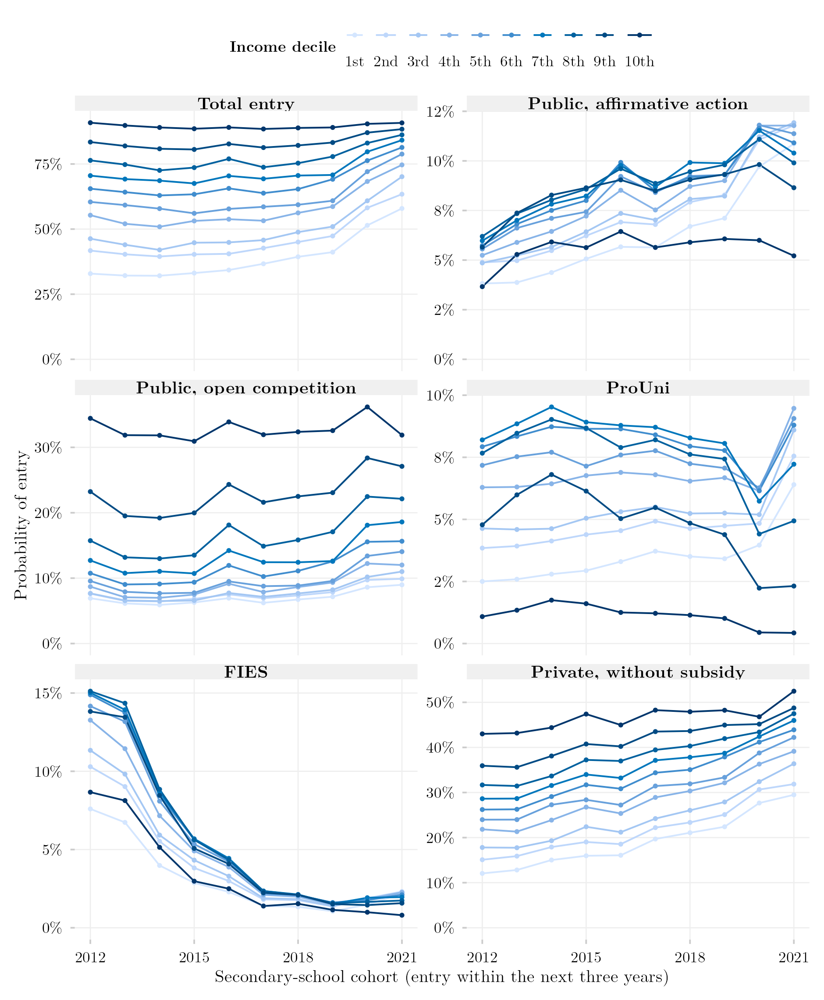
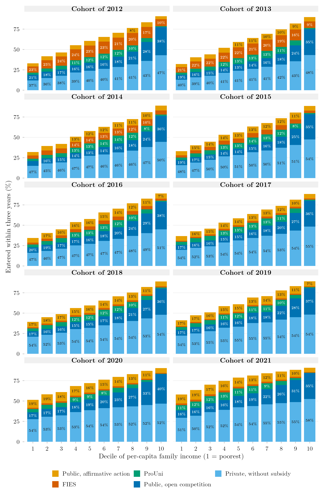
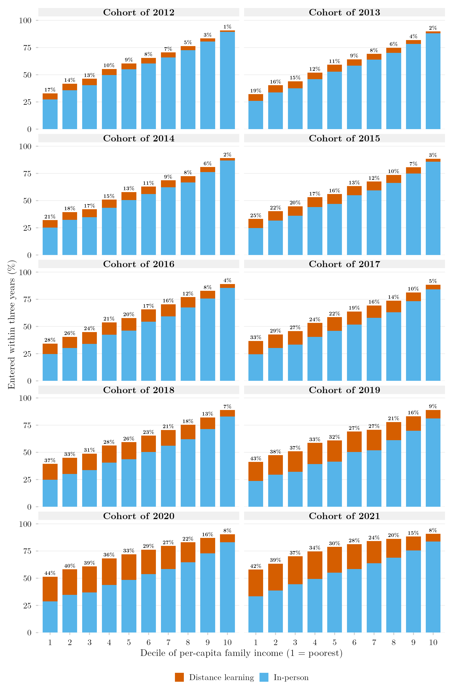
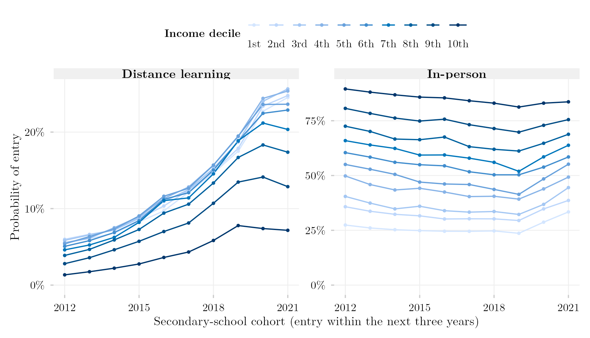
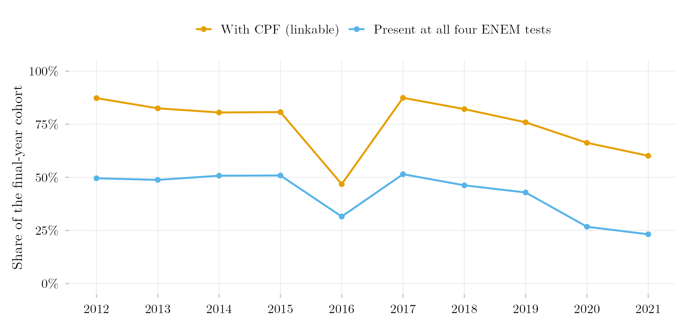

## Overview

This post extends the two-cohort comparison of [Routes into Tertiary Education by Per-Capita Income Decile](../portas-renda-coortes-empilhado/index.qmd) and [Mode of Study](../portas-renda-coortes-ead/index.qmd) to every secondary-school cohort that the linked records allow, from 2012 to 2021. Each line is one income decile; each point is the probability that a student of that decile and cohort entered tertiary education within the three years after the final school year. The first panel is total entry; the other five split it by route: a public institution through a reserved seat, a public institution through open competition, ProUni, FIES, or a private institution with no subsidy.

Three movements stand out. FIES collapses between the 2013 and 2015 cohorts, from 7–15% of each decile to 3–6%, and keeps falling. Unsubsidised private entry rises in every decile, from 12% to 30% in the poorest and from 43% to 53% in the richest between the 2012 and 2021 cohorts. And total entry of the poorest decile, flat at about a third until the 2016 cohort, climbs to 41% in 2019 and 58% in 2021, while the richest decile stays near 90%. The last rise coincides with the collapse of ENEM attendance in the pandemic editions and should not be read as a real change before the coverage figure below is taken into account.

## Composition of entry, cohort by cohort

The same numbers in the design of the two-cohort posts: for each cohort, each bar is an income decile, its height is the decile's total entry probability, and the segments split it by route; the percentage in each segment is that route's share of the decile's entrants (segments under 6 points are left unlabelled).

By mode of study, with distance learning's share of the decile's entrants above each bar:

## Mode of study

Distance-learning entry rises in every decile, but much faster at the bottom: in the poorest decile from 5.5% (2012 cohort) to 17.5% (2019) and 24.5% (2021); in the richest from 1.3% to 7.8% and 7.2%. In-person entry falls in most deciles until the 2019 cohort and recovers afterwards, again in the cohorts with the lowest ENEM coverage.

## Coverage

The population behind every probability is the part of the school cohort that has a linkable CPF and was present at all four objective ENEM tests of the cohort year. That part is about half of the final-year cohort from 2012 to 2017 and falls to 43% (2019), 27% (2020) and 23% (2021). The 2016 cohort is an exception within the stable years: only 47% of its final-year students have a CPF in the Censo Escolar, against 81–87% in the neighbouring years. When fewer and more selected students sit the ENEM, a decile of the remaining sample is a different group of people; the rises of the 2020 and 2021 cohorts in particular mix a change in entry with a change in who is observed.

## Methodology

**Cohort and linkage.** Each cohort is every student enrolled in the final year of secondary education in the Censo Escolar of the cohort year (`TP_ETAPA_ENSINO` in 27, 28, 29, 32, 33, 34, 37, 38), aged 16–22, linked by masked CPF to the ENEM of the same year and to the Censo da Educação Superior of the three following years.

**ENEM attendance (new).** The earlier two-cohort posts linked the cohort to ENEM *registration*: the ENEM tables have one row per registered candidate, including those who missed the tests. Absence varies widely between editions (29% missed the mathematics test in 2012, 55% in 2020) and has an income gradient, so a yearly series built on registration would change its population from one year to the next. Here a student is counted only if present at all four objective tests (`IN_PRESENCA_*` up to 2014, `TP_PRESENCA_*` from 2015). For the 2013 cohort this lowers the population from 1,229,035 registered to 1,064,350 present.

**Entry, route and mode.** A student counts as having entered if any enrolment record with a year of entry within the three following years appears in the Censo da Educação Superior. Each entrant receives one route by priority across all of that person's records: public with a reserved seat (`IN_RESERVA_VAGAS`), public through open competition, ProUni, FIES, private with no subsidy. Mode is distance learning if any record in the window is distance learning (`TP_MODALIDADE_ENSINO` = 2).

**Income deciles.** Declared family income bracket (seventeen brackets, midpoints in minimum wages) divided by the midpoint of the declared household-size group, as in the two-cohort posts; deciles are cut within each cohort and cells straddling a boundary are split proportionally. Income questions are `Q003`/`Q004` in 2012–2014 and `Q006`/`Q005` from 2015, checked against the data by the probe script below.

**Limits.**

- The 2011 cohort is left out: its ENEM income question uses a different set of eleven brackets whose midpoints have not been checked.
- `IN_RESERVA_VAGAS` and `IN_RESERVA_ETNICO` are empty in the 2024 Censo da Educação Superior. The other reservation flags (public school, income, disability, other) are filled in 2024, and in 2023 they are filled only for reserved-seat entrants, so a reserved seat is identified as `IN_RESERVA_VAGAS` = 1 or `IN_RESERVA_ENSINO_PUBLICO` filled. Up to 2023 this is the same rule; in 2024 it recovers the reserved-seat entrants of the 2021 cohort, whose share of the cohort (10.3%) is close to that of the 2020 cohort (10.6%).
- ProUni entry of the 2021 cohort is higher than in the neighbouring cohorts (6.5% of the cohort against 4.5% in 2020, about 40% more grantees in absolute numbers). The reservation fix does not change it. It has not been explained: the sharp fall in ENEM attendance in 2021, which ProUni requires, is one candidate.
- Distance-learning programmes do not require the ENEM, so the figures describe students who sat it, not all entrants.
- Counts carry the platform's differential-privacy noise; reported row loss is at most 2.3% per query (`data/row_loss.csv`).

## Reproduce

1. [`plot.R`](plot.R) reads the aggregate tables in `data/` and writes the three figures in English and Portuguese, plus `data/probabilidades_por_decil.csv` with every plotted value and `data/cobertura.csv`.
2. [`shared-pipeline/sedap/portas-anuais/010_Sondagem_Anual.R`](../../shared-pipeline/sedap/portas-anuais/010_Sondagem_Anual.R) checks, year by year, the ENEM income, household and attendance variables, the CPF coverage of the Censo Escolar and the route and mode flags of the Censo da Educação Superior (`data/sondagem_*.csv`).
3. [`shared-pipeline/sedap/portas-anuais/020_Extrair_Coortes_Anuais.R`](../../shared-pipeline/sedap/portas-anuais/020_Extrair_Coortes_Anuais.R) runs the two queries per cohort and writes `data/matriz_<cohort>_porta.csv` and `data/matriz_<cohort>_modalidade.csv`. The extraction scripts only run with an approved INEP credential exported as `SEDAP_TOKEN`.
