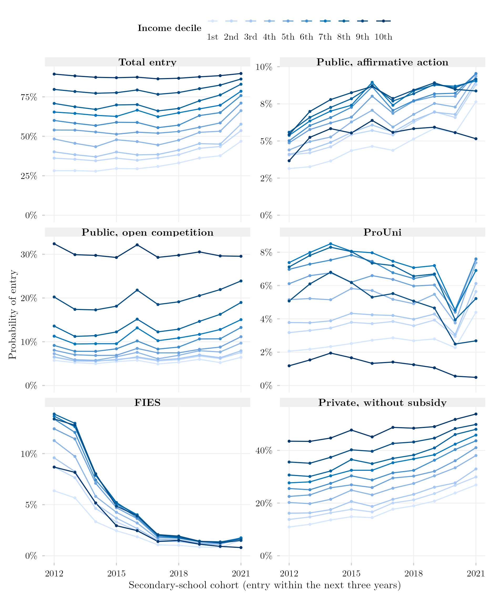
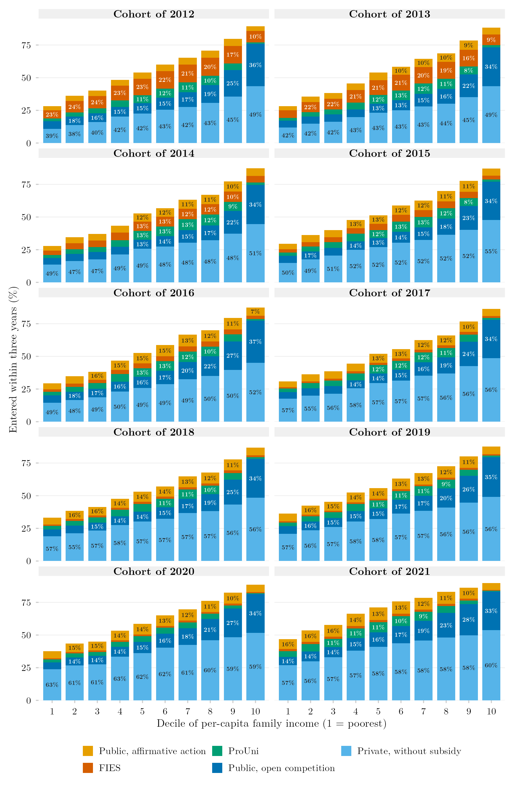
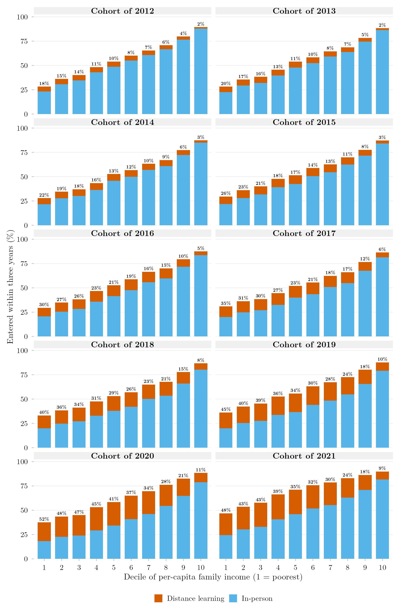
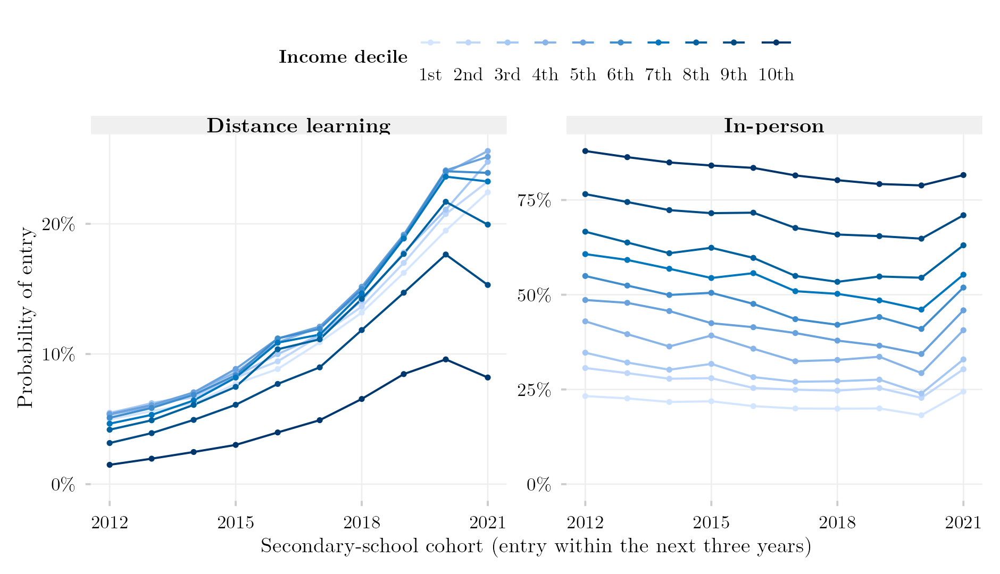
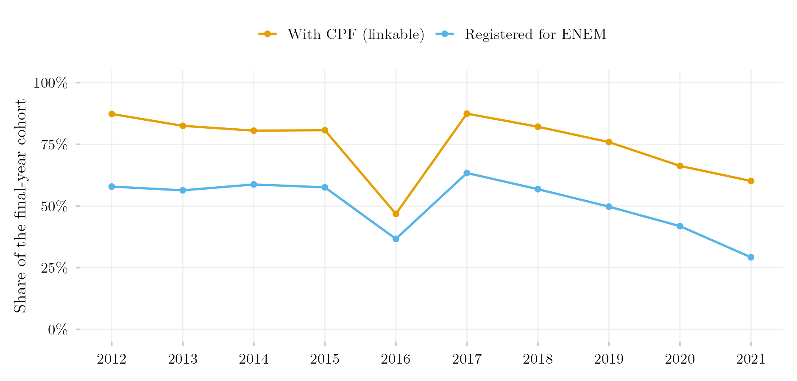

## Overview

This post extends the two-cohort comparison of [Routes into Tertiary Education by Per-Capita Income Decile](../portas-renda-coortes-empilhado/index.qmd) and [Mode of Study](../portas-renda-coortes-ead/index.qmd) to every secondary-school cohort that the linked records allow, from 2012 to 2021. Each line is one income decile; each point is the probability that a student of that decile and cohort entered tertiary education within the three years after the final school year. The first panel is total entry; the other five split it by route: a public institution through a reserved seat, a public institution through open competition, ProUni, FIES, or a private institution with no subsidy.

With registered students as the denominator, total entry in the poorest income decile rises from 28.2% in the 2012 cohort to 36.2% in 2019 and 46.9% in 2021; in the richest decile it remains near 90%. Unsubsidised private entry rises from 10.9% to 26.9% in the poorest decile and from 43.5% to 53.8% in the richest. These are conditional probabilities among linked ENEM registrants, rather than rates for the whole school cohort.

## Composition of entry, cohort by cohort

The same numbers in the design of the two-cohort posts: for each cohort, each bar is an income decile, its height is the decile's total entry probability, and the segments split it by route; the percentage in each segment is that route's share of the decile's entrants (segments under 6 points are left unlabelled).

By mode of study, with distance learning's share of the decile's entrants above each bar:

## Mode of study

Distance-learning entry in the poorest decile rises from 5.0% (2012) to 16.2% (2019) and 22.4% (2021); in the richest, from 1.5% to 8.5% and 8.2%. In-person entry in the poorest decile is 23.3%, 20.0% and 24.4% in those cohorts.

## Coverage

The population behind each probability consists of students in the school cohort with a linkable CPF who registered for ENEM that year, including those absent from the tests. They represent 57.9% of the final-year cohort in 2012, 49.8% in 2019, 41.8% in 2020 and 29.2% in 2021. CPF coverage itself falls to 46.8% in 2016 and 60.2% in 2021. Registration and linkage still select who is observed; these results cannot be extrapolated directly to all secondary-school students.

## Methodology

**Cohort and linkage.** Each cohort is every student enrolled in the final year of secondary education in the Censo Escolar of the cohort year (`TP_ETAPA_ENSINO` in 27, 28, 29, 32, 33, 34, 37, 38), aged 16–22, linked by masked CPF to the ENEM of the same year and to the Censo da Educação Superior of the three following years.

**ENEM registration.** The default is `POPULACAO=inscritos`, matching the two-cohort posts. Income is reported at registration, so absent students also have an income bracket. Requiring attendance would select on a behaviour associated with subsequent entry. `POPULACAO=presentes` remains available as a sensitivity analysis, with separate extraction and figure directories. The published figures and redistributed matrices now use registrants.

**Entry, route and mode.** A student counts as having entered if any enrolment record with a year of entry within the three following years appears in the Censo da Educação Superior. Each entrant receives one route by priority across all of that person's records: public with a reserved seat (`IN_RESERVA_VAGAS`), public through open competition, ProUni, FIES, private with no subsidy. Mode is distance learning if any record in the window is distance learning (`TP_MODALIDADE_ENSINO` = 2).

**Income deciles.** Declared family income bracket (seventeen brackets, midpoints in minimum wages) divided by the midpoint of the declared household-size group, as in the two-cohort posts; deciles are cut within each cohort and cells straddling a boundary are split proportionally. Income questions are `Q003`/`Q004` in 2012–2014 and `Q006`/`Q005` from 2015, checked against the data by the probe script below.

**Limits.**

- The 2011 cohort is left out: its ENEM income question uses a different set of eleven brackets whose midpoints have not been checked.
- `IN_RESERVA_VAGAS` and `IN_RESERVA_ETNICO` are empty in the 2024 Censo da Educação Superior. The other reservation flags (public school, income, disability, other) are filled in 2024, and in 2023 they are filled only for reserved-seat entrants, so a reserved seat is identified as `IN_RESERVA_VAGAS` = 1 or `IN_RESERVA_ENSINO_PUBLICO` filled. This rule also recovers reserved-seat entrants recorded in 2024.
- Changes in ProUni entry and other routes can combine changes in access with changes in registration and record linkage; the aggregate tables do not identify a causal explanation.
- Distance-learning programmes do not require ENEM; these figures describe its registrants, including absentees, rather than all entrants.
- Counts carry the platform's differential-privacy noise; reported row loss is at most 2.3% per query (`data/row_loss.csv`).

## Reproduce

1. [`plot.R`](plot.R) reads the aggregate tables in `data/` and writes the three figures in English and Portuguese, plus `data/probabilidades_por_decil.csv` with every plotted value and `data/cobertura.csv`.
2. [`shared-pipeline/sedap/portas-anuais/010_Sondagem_Anual.R`](../../shared-pipeline/sedap/portas-anuais/010_Sondagem_Anual.R) checks, year by year, the ENEM income, household and attendance variables, the CPF coverage of the Censo Escolar and the route and mode flags of the Censo da Educação Superior (`data/sondagem_*.csv`).
3. [`shared-pipeline/sedap/portas-anuais/020_Extrair_Coortes_Anuais.R`](../../shared-pipeline/sedap/portas-anuais/020_Extrair_Coortes_Anuais.R) runs the two queries per cohort and writes `data-raw/sedap/portas-anuais/inscritos/matriz_<cohort>_porta.csv` and `matriz_<cohort>_modalidade.csv`. The extraction scripts only run with an approved INEP credential exported as `SEDAP_TOKEN`.

The plotter uses a complete extraction for the selected population, or the matching redistributed snapshot identified by `data/populacao.csv`. It refuses incomplete caches and population mismatches. The default run updates the published registrant aggregates and figures. A sensitivity run with `POPULACAO=presentes` writes only to `output/figures/portas-renda-coortes-anuais/presentes/`.
