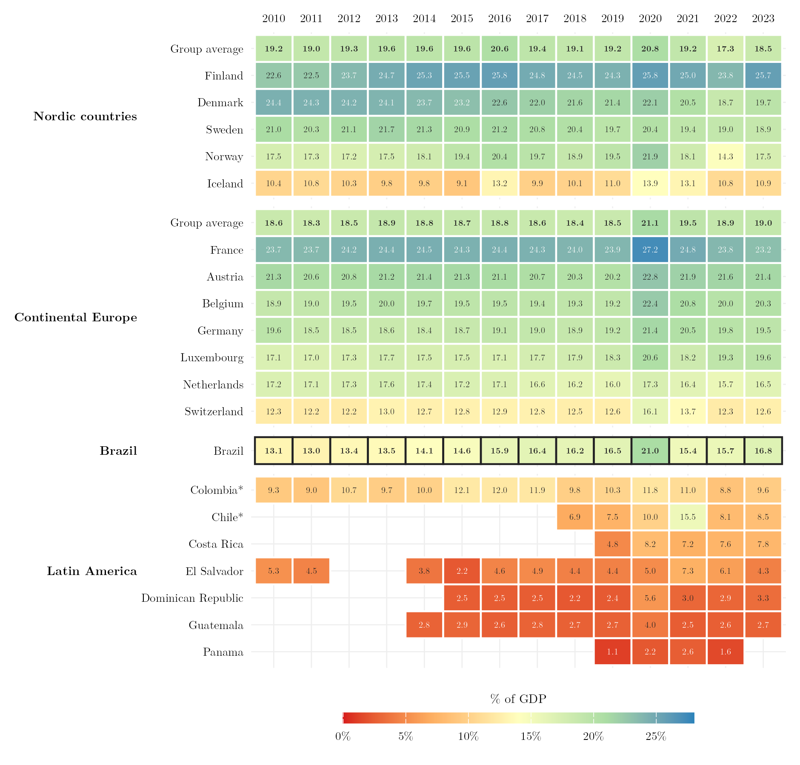

## Overview

This figure compares Brazil's general government spending on social protection with the Nordic countries, continental Europe and the Latin American countries with available data, year by year from 2010 to 2023. Brazil went from 13.1% of GDP in 2010 to 16.8% in 2023, with a peak of 21.0% in 2020, the first year of the pandemic. In 2023 the Nordic average was 18.5% and the continental European average 19.0%. Among the Latin American countries with data, Colombia spent 9.6% and Chile 8.5% in 2023.

## Methodology

**The function.** Social protection is division 710 of the Classification of the Functions of Government (COFOG). It covers sickness and disability, old age, survivors, family and children, unemployment, housing and social exclusion. In Brazil, it therefore includes both contributory pensions (RGPS and civil servants' regimes) and social assistance programs.

**Coverage of government.** All values refer to general government (sector S13: central, state and local governments and social security funds), as a share of nominal GDP.

**Sources.** The main source is the IMF's Government Finance Statistics (dataflow `IMF.STA:GFS_COFOG`, transformation `POGDP_PT`). Chile and Colombia have no general government series for this function in the IMF data; they come from the OECD national accounts: Table 11 (`DSD_NASEC10@DF_TABLE11`, total expenditure on function GF10, in national currency) divided by nominal GDP from Table 1 (`DSD_NAMAIN10@DF_TABLE1_EXPENDITURE`). These two countries carry an asterisk. As a check, the same OECD calculation for France matches the IMF value in every year from 2010 to 2023.

**Groups.** Nordic countries: Denmark, Finland, Iceland, Norway and Sweden. Continental Europe: Austria, Belgium, France, Germany, Luxembourg, the Netherlands and Switzerland. Both European groups have data for every year, and their average row is a simple mean. Latin America has no average row, because the set of countries with data changes from year to year and the average would change composition along with it.

**Limits.** Argentina, Bolivia, Ecuador, Mexico, Paraguay, Peru and Uruguay have no general government series for this function between 2010 and 2023 in either source; blank cells mark missing years. For Costa Rica the IMF and the OECD diverge (2019: 4.8% in the IMF, 7.8% in the OECD); the figure uses the IMF, as for the other countries. Spending as a share of GDP measures fiscal effort, not coverage, benefit adequacy or the distribution of benefits.

## How to Cite

If you use this figure or the pipeline behind it, please cite both the dissertation and this specific analysis. References follow APA 7th edition.

**Dissertation (in preparation; the entry will be updated after the defense):**

> Mançano, T. (2026). *Inequality in access to tertiary education in Brazil: Household incomes, reforming policies, and the politics of who gets in (1990s–2020s)* [Unpublished master's thesis]. University of São Paulo.

**This figure and pipeline:**

> Mançano, T. (2026, November 12). *Social protection spending: Brazil, Europe and Latin America* [Figure and reproducible pipeline]. Open Data Analysis. https://mancano-tales.github.io/open-data-analysis/posts/protecao-social-brasil-europa-america-latina/

**In text:** (Mançano, 2026) — when citing several analyses from this catalog in the same work, APA distinguishes them as 2026a, 2026b, … in the order they appear in the reference list.

**BibTeX:**

```bibtex
@mastersthesis{Mancano2026Thesis,
  author = {Man\c{c}ano, Tales},
  title  = {Inequality in Access to Tertiary Education in Brazil: Household
            Incomes, Reforming Policies, and the Politics of Who Gets In
            (1990s--2020s)},
  school = {University of S\~{a}o Paulo},
  year   = {2026},
  type   = {Master's thesis},
  note   = {Unpublished; Graduate Program in Political Science}
}

@misc{Mancano2026_protecao_social_brasil_europa_america_latina,
  author       = {Man\c{c}ano, Tales},
  title        = {Social protection spending: Brazil, Europe and Latin America},
  year         = {2026},
  month        = nov,
  howpublished = {Open Data Analysis, \url{https://mancano-tales.github.io/open-data-analysis/posts/protecao-social-brasil-europa-america-latina/}},
  note         = {Figure and reproducible pipeline. Source code: \url{https://github.com/mancano-tales/open-data-analysis}, folder posts/protecao-social-brasil-europa-america-latina/. Accessed YYYY-MM-DD}
}
```

A permanent version (Git tag + Zenodo DOI) will be linked here once the dissertation is defended; until then, cite the page URL above and add the date you accessed it (source code: https://github.com/mancano-tales/open-data-analysis, folder `posts/protecao-social-brasil-europa-america-latina/`).

## Pipeline

Scripts for this analysis:

- Upstream data: [`shared-pipeline/cofog/010_COFOG_Protecao_Social.R`](../../shared-pipeline/cofog/010_COFOG_Protecao_Social.R) — queries the IMF and OECD SDMX APIs and writes `data/protecao_social.csv`.
- Plotting: [`plot.R`](plot.R) — reads `data/` and writes `fig-en.png`, `fig-pt.png` and `thumbnail.png`.

## Reproducibility

**Tier: A**

This pipeline uses only public data from the IMF and OECD APIs, with no credential. The CSV in `data/` is enough to redraw the figure.
