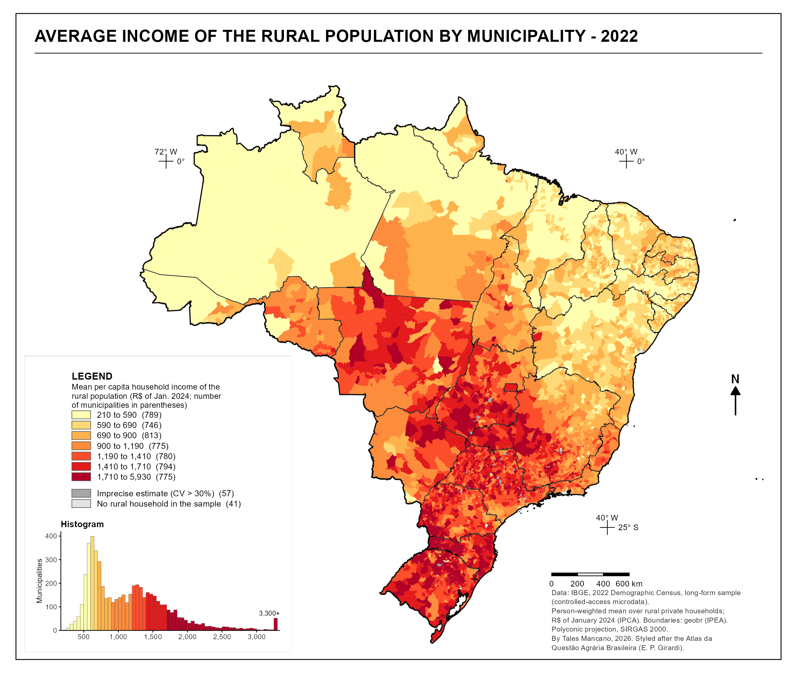

[Download the municipal data (CSV)](data/renda_rural_municipio_2022.csv){.btn .btn-outline-primary download="renda_rural_municipio_2022.csv"}

One row per municipality with a rural household in the sample (5,529 rows, UTF-8, comma-separated): code and name, state, region, sample size, estimated rural population, mean and median per capita income (reais of January 2024 and nominal), standard error, coefficient of variation and share with zero income. Column definitions are under [Pipeline](#pipeline).

## Overview

The map shows, for each municipality, the mean per capita household income of people living in rural households, from the long-form sample of the 2022 Demographic Census.
Values are in reais of January 2024.
The estimated rural population is 25.3 million people, with a mean income of R$ 910 per person (R$ 864 at July 2022 prices).

The regional mean, weighted by rural population, ranges from R$ 612 in the North and R$ 621 in the Northeast to R$ 1,180 in the Southeast, R$ 1,329 in the Center-West and R$ 1,721 in the South.
The Northeast holds 12.2 million of the 25.3 million rural residents.
About a third of the municipalities in the North (37%) and Northeast (34%) fall in the lowest class of the map, up to R$ 590, while 43% of the municipalities in the South fall in the highest, above R$ 1,710.

The map's form follows the conventions of the *Atlas da Questão Agrária Brasileira* by Eduardo Paulon Girardi (NERA/UNESP): a framed map with an upper-case title, municipalities drawn without outlines, an ordered yellow-to-dark-red palette, a legend with a histogram of the distribution, coordinate crosses and a polyconic projection. A Portuguese version of the figure is on the [Portuguese page](https://mancano-tales.github.io/open-data-analysis/pt/posts-pt/renda-rural-municipio-2022/).

## Methodology

**Source.** Controlled-access microdata of the 2022 Census long-form sample, requested from IBGE and read with `censobr::import_microdata22_controlado()`.
The sample has 1.43 million rural households and 4.19 million people.

**Definitions.** A household is rural when `D0140` = 2 (village, rural nucleus, hamlet or rural area outside agglomerations).
Income is `D0360`, the per capita household income computed by IBGE itself, which excludes the income of boarders, domestic workers and their relatives.
The unit of analysis is the person living in a rural private household, excluding those three conditions and residents of collective dwellings (`P0170` 17–20, `P0130` = 6).
Each person carries the per capita income of their household, and the municipal mean is weighted by the sample weight `P0111`.
Households with zero income are included and hold 2.6% of the rural population.
July 2022 values (the Census reference date) are brought to January 2024 with the IPCA consumer price index (factor 1.0536).

**Classes.** Seven quantile classes, rounded to tens of reais, computed over municipalities with an acceptable estimate.
Each class holds between 746 and 813 municipalities.

**Precision.** The standard error of each municipal mean is approximated by linearization, with the household as the primary sampling unit.
The approximation ignores strata and the calibration of weights by weighting area, so it tends to overstate the error slightly.
The 57 municipalities in medium grey have a coefficient of variation above 30% (55) or a single rural household in the sample (2).
The 41 in light grey have no rural household in the sample.
The median coefficient of variation across municipalities is 7%.

**Mean and median.** The mean is sensitive to a few high incomes, especially where the rural sample is small.
The redistributed table also reports each municipality's weighted median, standard error and sample size.

## How to Cite

If you use this figure or the pipeline behind it, please cite both the dissertation and this specific analysis. References follow APA 7th edition.

**Dissertation (in preparation; the entry will be updated after the defense):**

> Mançano, T. (2026). *Inequality in access to tertiary education in Brazil: Household incomes, reforming policies, and the politics of who gets in (1990s–2020s)* [Unpublished master's thesis]. University of São Paulo.

**This figure and pipeline:**

> Mançano, T. (2026, November 11). *Average income of the rural population by municipality, 2022* [Figure and reproducible pipeline]. Open Data Analysis. https://mancano-tales.github.io/open-data-analysis/posts/renda-rural-municipio-2022/

**In text:** (Mançano, 2026) — when citing several analyses from this catalog in the same work, APA distinguishes them as 2026a, 2026b, … in the order they appear in the reference list.

**BibTeX:**

```bibtex
@mastersthesis{Mancano2026Thesis,
  author = {Man\c{c}ano, Tales},
  title  = {Inequality in Access to Tertiary Education in Brazil: Household
            Incomes, Reforming Policies, and the Politics of Who Gets In
            (1990s--2020s)},
  school = {University of S\~{a}o Paulo},
  year   = {2026},
  type   = {Master's thesis},
  note   = {Unpublished; Graduate Program in Political Science}
}

@misc{Mancano2026_renda_rural_municipio_2022,
  author       = {Man\c{c}ano, Tales},
  title        = {Average income of the rural population by municipality, 2022},
  year         = {2026},
  month        = nov,
  howpublished = {Open Data Analysis, \url{https://mancano-tales.github.io/open-data-analysis/posts/renda-rural-municipio-2022/}},
  note         = {Figure and reproducible pipeline. Source code: \url{https://github.com/mancano-tales/open-data-analysis}, folder posts/renda-rural-municipio-2022/. Accessed YYYY-MM-DD}
}
```

A permanent version (Git tag + Zenodo DOI) will be linked here once the dissertation is defended; until then, cite the page URL above and add the date you accessed it (source code: https://github.com/mancano-tales/open-data-analysis, folder `posts/renda-rural-municipio-2022/`).

## Pipeline

The figure reads one aggregate table redistributed in the post's [`data/`](data/) folder, [`renda_rural_municipio_2022.csv`](data/renda_rural_municipio_2022.csv), with one row per municipality that has a rural household in the sample (5,529 rows): municipality code and name, state, region, sample size, estimated rural population, mean and median per capita income (in reais of January 2024 and nominal), standard error, coefficient of variation and share with zero income.

1. [`plot.R`](plot.R) — joins the table to the `geobr` municipal boundaries, sets the classes and writes `fig-en.png`, `fig-pt.png` and `thumbnail.png`.

To recompute the table from the microdata (requires IBGE's controlled-access zip already imported into the `censobr` cache):

1. [`shared-pipeline/censo/050_Renda_Rural_Municipio_2022.R`](../../shared-pipeline/censo/050_Renda_Rural_Municipio_2022.R) — aggregates the microdata by municipality and writes `data/renda_rural_municipio_2022.csv`.

## Reproducibility

**Tier: B (redistributed aggregate)** — the figure reproduces without credentials from the redistributed aggregate table; recomputing it requires the 2022 Census controlled-access microdata.

The table carries no individual record: each row is a municipal statistic estimated over all rural residents in the municipality's sample.
The 2022 Census long-form controlled-access microdata are requested from IBGE at https://microdados.ibge.gov.br/, and `censobr::import_microdata22_controlado()` (development branch of the package, tested at commit `dd48725`) only processes a file the user already holds.
