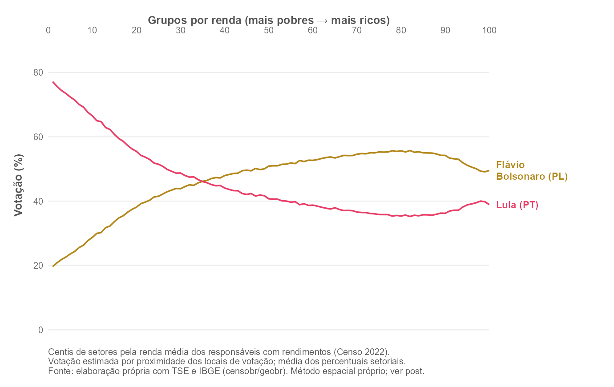

## Overview

This post reconstructs the income–vote chart published by Daniel Mariani,
Paula Soprana and Nicholas Pretto in
[Folha de S.Paulo on October 12, 2026](https://www1.folha.uol.com.br/poder/2026/10/flavio-bolsonaro-supera-votos-do-pai-em-todas-as-rendas-e-lula-cresce-entre-mais-ricos.shtml).

::: {.callout-note}
**Approximate reproduction.** National processing and numerical checks were
completed with public data. The spatial assignment is an independent
implementation because the article does not specify all proximity parameters.
The resulting curves differ from the reference image, and the maximum-distance
choice has a material effect.
:::

## Results and coverage

The main 5 km estimate includes **410,010 tracts** out of the 458,772 in the
income table (89.37%). Exclusions comprise 9,241 without eligible income,
39,483 beyond the distance limit and 38 without an available spatial match.
Each percentile contains 4,100 or 4,101 tracts.

At percentile 46, Lula receives **42.35%**, with mean tract income of **1.68
minimum wages**; the supplied reference image shows 41.12% and 1.69. The vote
share difference is 1.23 percentage points. At percentile 100, estimates are
38.90% for Lula and 49.53% for Flávio, with income of 16.52 minimum wages.
Flávio first exceeds Lula at percentile 35 under this implementation. These
percentiles rank tracts and do not identify fractions of the population voting
for either candidate.

| Maximum distance | Included tracts |
|---|---:|
| 1 km | 326,951 |
| 2 km | 368,147 |
| 5 km (main figure) | 410,010 |

Comparing equally numbered percentiles under 1 and 5 km gives maximum
differences of 6.32 percentage points for Lula and 5.51 for Flávio. Each
distance recalculates its sample and percentile ranking, so these differences
combine coverage and composition. Excluding tracts far from polling places
requires care, particularly when interpreting rural areas. The association
is territorial and descriptive.

The audit found **6,588 polling-place discrepancies across 497,897 sections**
between results and the current voter register. Calculations use the place
recorded in results. Of 91,087 locations with votes and usable coordinates,
818 were incompatible with the 2022 municipal boundaries and excluded;
90,269 places remained eligible for spatial assignment.

The [100 calculated percentiles](data/centis.csv),
[sensitivity estimates](data/sensibilidade.csv) and
[coverage and provenance records](data/README.md) accompany the post.

## Methodology

`censobr::read_tracts(year = 2022, dataset = "ResponsavelRenda")` provides
tract income. `V06004` measures mean nominal monthly income of household
heads **with income** in occupied permanent private households; `V06001`
counts household heads. This is neither per capita household income nor
mean income of all residents. Tracts without household heads or with missing
or suppressed income are excluded. Income is divided by BRL 1,212 to express
it in 2022 minimum wages. Definitions follow the
[official IBGE dictionary](https://ftp.ibge.gov.br/Censos/Censo_Demografico_2022/Agregados_por_Setores_Censitarios_Rendimento_do_Responsavel/dicionario_de_dados_renda_responsavel_20260508.xlsx).

The pipeline downloads **2026 presidential votes by electoral section** from
the [TSE results dataset](https://dadosabertos.tse.jus.br/dataset/resultados-2026)
through its public CKAN API. It selects the first round and presidency. Valid
votes for all candidates form the denominator; blank and invalid votes are
excluded. The two displayed candidates therefore need not sum to 100%.
[`electionsBR::vote_section()`](https://github.com/silvadenisson/electionsBR)
is a related R option, but the consulted source documents years through 2024;
the pipeline uses the official 2026 download directly.

Electoral sections and census tracts have different boundaries and codes.
The results file itself links sections to polling places. The
[2026 polling-place register](https://dadosabertos.tse.jus.br/dataset/eleitorado-2026)
provides an independent audit: when the two disagree, the results' place code
takes precedence, preserving the location recorded in the count rather than
overwriting it with the current register. Coordinates come from
[`geobr::read_polling_places(year = 2026)`](https://ipea.github.io/geobr/reference/read_polling_places.html),
which combines TSE coordinates and `geocodebr` geocoding. Repeated records
with identical coordinates are collapsed; conflicting locations are excluded.
Points must lie within their municipalities' 2022 boundaries from `geobr`.
The independent spatial estimator assigns each
tract the vote shares of the nearest valid polling place to an interior
point, within the same municipality and a configurable maximum distance.
Votes are summed across sections at each polling place before computing
shares. These are neighbourhood estimates, not observed votes of tract
residents. This differs from the original article's unspecified proximity
and geocoding details.

Eligible tracts are ranked by income, with tract code breaking ties, then
divided into 100 groups as equal in tract count as possible. Group vote
shares are unweighted means of tract percentages. These are tract percentiles,
not percentiles of people, voters or households. Exclusions are recorded;
maximum-distance sensitivity is examined explicitly.
Reported centile income is the unweighted mean of tract mean incomes, in
minimum wages. Distance ties between polling places are broken by the
ordered composite state, municipality, electoral zone and place code.

## Pipeline

Run from the repository root:

1. [`010_Download_Censo_TSE.R`](../../shared-pipeline/eleicoes/010_Download_Censo_TSE.R)
   — downloads tract income through `censobr` and official 2026 votes and
   polling places through TSE, retaining source metadata and checksums.
2. [`020_Cruzar_Setores_Votos.R`](../../shared-pipeline/eleicoes/020_Cruzar_Setores_Votos.R)
   — downloads boundaries and locations through `geobr`, validates keys,
   matches places and tracts, records exclusions and writes
   `data-raw/eleicoes-renda/centis.csv`.
3. [`030_Verificar_Resultados.R`](../../shared-pipeline/eleicoes/030_Verificar_Resultados.R)
   — checks percentages, 100 centiles, counts and means using independent
   calculations with base R functions.
4. [`plot.R`](plot.R) — writes PNG and PDF to
   `output/figures/votacao-renda-centil/`.

The figure uses unsmoothed lines, a top income axis, direct labels and colours
similar to the reference. The screenshot's 41.12% at percentile 46 and income
of 1.69 minimum wages are comparison targets, not hard-coded observations.

The default maximum distance is 5 km. Set `VOTOS_MAX_DIST_M` in metres before
running `020` to choose another limit. `sensibilidade.csv` includes the
1, 2 and 5 km curves plus the selected limit. National processing downloads
detailed boundaries and may take time and several gigabytes of memory;
inputs are cached.
The three data stages are also included in
[`build_public_data.R`](../../shared-pipeline/build_public_data.R).

## Reproducibility

**Tier: A — public sources.** National output passed independent checks of
place-level shares, valid-vote denominators, 100 percentile groups, counts,
means and income units. This remains an editorial draft with the spatial
approximation and sensitivity documented. The aggregate output requires no
credentials or identifiable individual data.

To redraw the figure without upstream downloads, run `plot.R` alone: it uses
the aggregate snapshot in `posts/votacao-renda-centil/data/` when recalculated
data are absent from `data-raw/eleicoes-renda/`. Package versions and input
checksums accompany the snapshot.

## How to cite

> Mançano, T. (2026, October 14). *Presidential vote by census tract income
> percentile* [Figure and approximate-reproduction pipeline]. Open Data Analysis.

Credit the original analysis to Mariani, Soprana and Pretto (Folha de S.Paulo,
2026). Cite this independent implementation separately; it does not imply
validation by the original authors.
